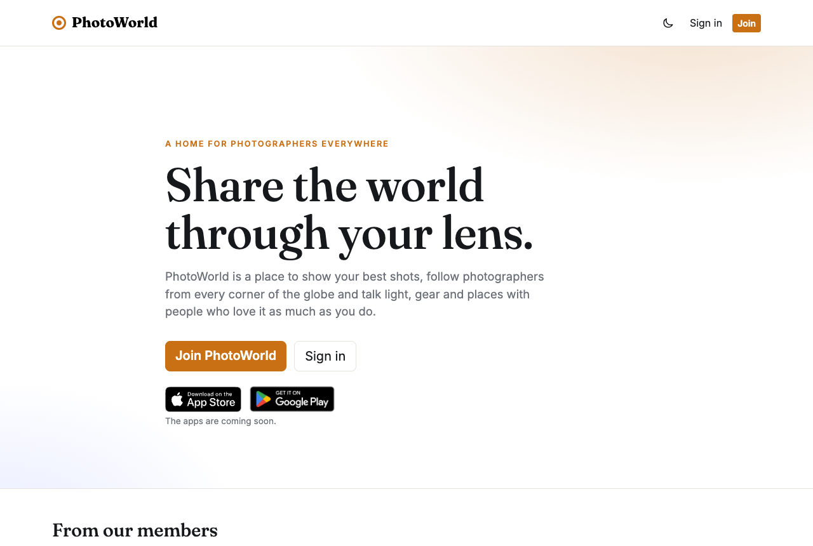
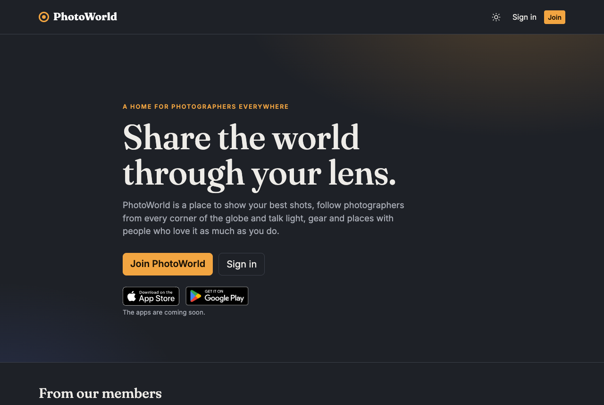
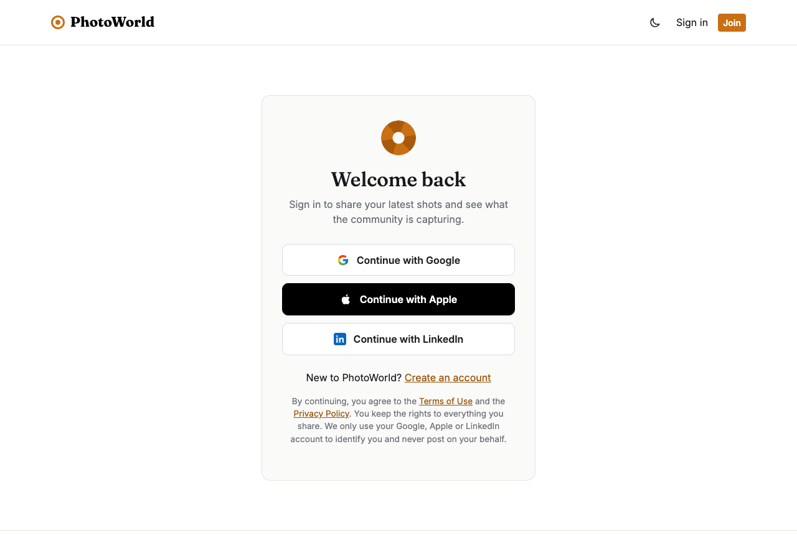
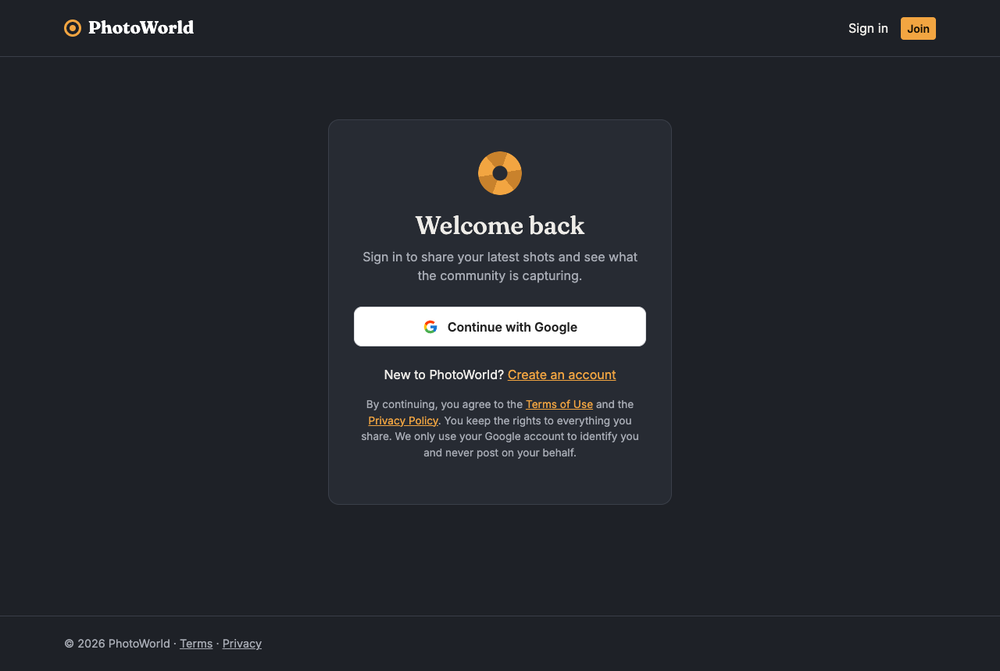
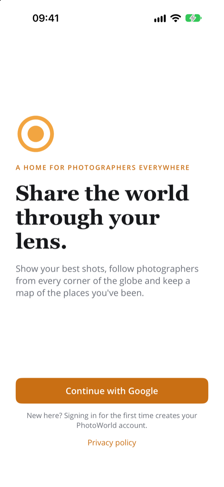
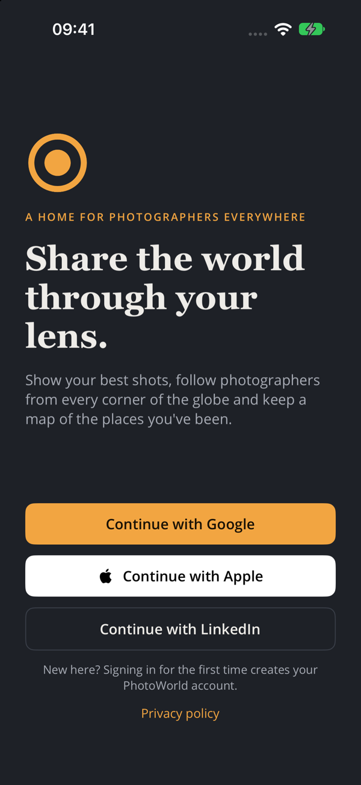
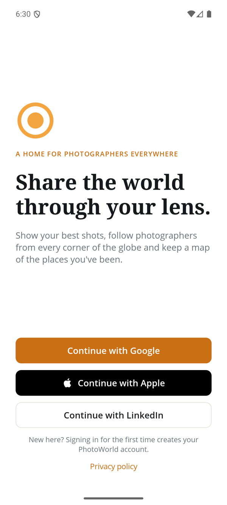
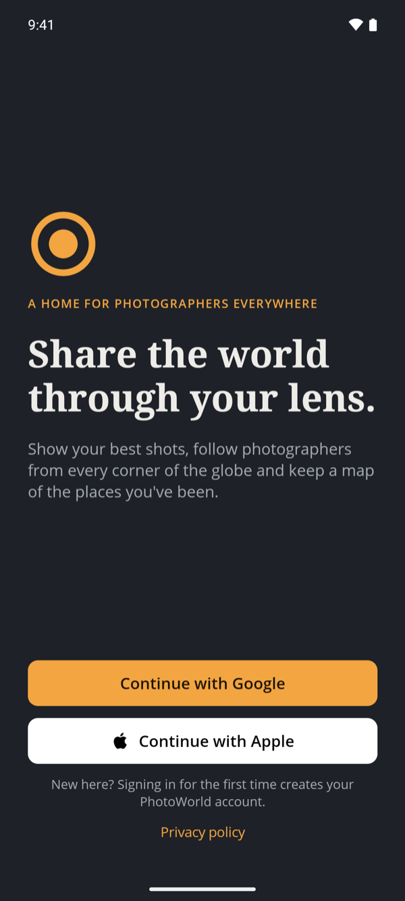

# PhotoWorld

A portal for sharing a passion for photography with people around the world.
ASP.NET Core MVC on **.NET 10**, split into an API, a UI and a shared library, plus a .NET MAUI app for
iPhone, iPad and Android.

How the pieces fit together (diagrams of the components, sign-in, requests, photos, data model, CI):
[docs/ARCHITECTURE.md](docs/ARCHITECTURE.md).

```
PhotoWorld.slnx
├── src/PhotoWorld.Shared   Class library: DTOs, API routes, provider names, claim types, Supabase logger (used by both)
├── src/PhotoWorld.Api      Web API: members, photos, blogs, challenges, activity, push… (Supabase Postgres + Storage), JWT issuing
├── src/PhotoWorld.Web      MVC UI: members-only pages, cookie auth, Google sign-in, admin pages
├── src/PhotoWorld.App      .NET MAUI app for iPhone, iPad and Android (talks to the API; signs in through Web)
└── tests/PhotoWorld.Api.Tests  xUnit tests: rules, visibility, image processing, HTML, push formats
```

## What it looks like

PhotoWorld has a light look (Gallery White) and a soft dark one (Graphite). It follows the device's setting, and the
moon/sun icon switches it on the website and in the apps. These are the signed-out screens; everything else needs a
member account.

| Website, light | Website, dark |
|---|---|
|  |  |
|  |  |

| iPhone, light | iPhone, dark | Android, light | Android, dark |
|---|---|---|---|
|  |  |  |  |

## How sign-in works

1. The user clicks **Continue with Google** on `/Account/Login` (or `/Account/Register`).
2. **Web** runs the OAuth flow with the provider and receives the provider's access token.
3. **Web** sends it to **API** `POST /api/auth/external`. The API checks the token **directly with Google**
   (`tokeninfo`), confirming it was issued to PhotoWorld.
4. The API finds or **registers** the user (first sign-in = registration). An account with the same verified
   email from another provider is linked, so it doesn't create a duplicate. It then returns a PhotoWorld JWT.
5. **Web** signs the user in with a cookie that carries the JWT and attaches it to later API calls (`GET /api/users/me`).

## Supabase (database + logs)

All data lives in a Supabase Postgres database, in a dedicated **`photoworld`** schema. It's kept out of
`public` on purpose: Supabase's auto-generated Data API exposes `public` tables to anyone holding the anon key.

| Table | Written by | Contents |
|---|---|---|
| `photoworld.users`, `photoworld.external_logins` | API (EF Core) | Members (incl. admin flag and suspension) and their linked Google accounts |
| `photoworld.photos`, `photo_likes`, `photo_comments` | API (EF Core) | Photo details (title, camera settings, file paths), likes and comments |
| `photoworld.blogs`, `blog_posts`, `blog_post_photos`, `blog_attachments`, `blog_comments` | API (EF Core) | Members' blogs, posts (sanitized HTML), the photos each post embeds, attached PDFs, and comments |
| `photoworld.places` | API (EF Core) | Places each member has pinned on their private map (name, note, visit date, coordinates); a photo can link to one (Spots map) |
| `photoworld.follows` | API (EF Core) | Who follows whom (for the Following tabs and follower counts) |
| `photoworld.blocks` | API (EF Core) | Who blocked whom (hides the blocked member's content from the blocker) |
| `photoworld.collections`, `collection_photos` | API (EF Core) | Members' photo collections (private or public) and the photos in them |
| `photoworld.activities`, `activity_settings` | API (EF Core) | Members' notifications (kept 90 days) and which kinds they want (incl. push) |
| `photoworld.photo_tags` | API (EF Core) | Tags on photos (normalised, without `#`) |
| `photoworld.photos_of_the_day` | API (EF Core) | The admins' photo of the day, one per UTC date |
| `photoworld.photo_feedback` | API (EF Core) | Members' ratings and comments on photos that ask for feedback (private to the owner) |
| `photoworld.devices` | API (EF Core) | Phones registered for push notifications (APNs / FCM tokens) |
| `photoworld.challenges`, `challenge_entries` | You (Supabase dashboard) / API | Photo challenge themes and dates, and the photos entered in each |
| `photoworld.reports`, view `open_reports` | API (EF Core) | Members' reports about photos, comments, blog posts and blog comments, and the moderation queue |
| Storage bucket `photos` (public) | API | The photo files: `{userId}/{photoId}/display.jpg` and `thumb.jpg` |
| Storage bucket `attachments` (public) | API | PDFs attached to blog posts: `{userId}/{postId}/{attachmentId}.pdf` |
| `photoworld.app_logs` | API **and** Web (`SupabaseLoggerProvider`) | Application logs, tagged with `application` = `PhotoWorld.Api` / `PhotoWorld.Web` |
| `photoworld.__ef_migrations_history` | API | Applied EF migrations |

**1. Connect the API.** In the Supabase dashboard, click **Connect** and copy the **Session pooler**
connection string in .NET format. (The direct connection is IPv6-only on the free plan; the transaction
pooler doesn't support the bulk COPY the logger uses.)

```bash
dotnet user-secrets set "ConnectionStrings:PhotoWorld" "User Id=postgres.<project-ref>;Password=<db-password>;Server=aws-0-<region>.pooler.supabase.com;Port=5432;Database=postgres;SSL Mode=Require" --project src/PhotoWorld.Api
```

Create the schema and tables by applying the EF migrations (`dotnet ef` picks up the connection string
from the API's user-secrets):

```bash
dotnet tool restore
dotnet ef database update --project src/PhotoWorld.Api
```

Or run [`docs/supabase-schema.sql`](docs/supabase-schema.sql) in the SQL editor. The API doesn't migrate on
startup. If the database is behind the code, it logs a warning listing the missing migrations.

**2. Logging connection.** The UI must not hold the main database password, so it logs through an
insert-only role. Run [`docs/supabase-logging-role.sql`](docs/supabase-logging-role.sql) in the SQL editor
(change the password first), then:

```bash
dotnet user-secrets set "ConnectionStrings:Logging" "User Id=photoworld_logger.<project-ref>;Password=<logger-password>;Server=aws-0-<region>.pooler.supabase.com;Port=5432;Database=postgres;SSL Mode=Require" --project src/PhotoWorld.Web
```

The API logs with `ConnectionStrings:Logging` if set, otherwise its main connection. Without any logging
connection string, Web still runs and logs to the console only.

Logs are batched in memory and bulk-inserted every ~2 seconds, so logging never slows down a request.
If Supabase is unreachable, that batch is dropped and a `[SupabaseLogger]` line goes to stderr.
A nightly `pg_cron` job (03:15 UTC, created by the `LogRetention` migration) deletes log rows older than
30 days. Check it with `select * from cron.job;`.

What gets stored is controlled by `Logging:Supabase:LogLevel` in each `appsettings.json` (default: Information,
framework noise at Warning).

```sql
-- Latest errors from either app
select timestamp, application, category, message, exception
from photoworld.app_logs where level in ('Error', 'Critical') order by timestamp desc limit 50;

-- Follow one request across Web and API
select timestamp, application, message, properties from photoworld.app_logs
where trace_id = '<trace id>' order by timestamp;
```

New EF migrations: `dotnet ef migrations add <Name> --project src/PhotoWorld.Api --output-dir Data/Migrations`.

## CI

[`.github/workflows/ci.yml`](.github/workflows/ci.yml) builds every push and pull request: the server projects
and tests on Linux, the app for the iOS Simulator on a macOS runner, and the Android app on Linux. On `main`, once the
server build is green, it applies any pending EF migrations to Supabase. It needs one repository secret,
`SUPABASE_DB_CONNECTION_STRING`, holding the Session pooler connection string for the `postgres` user
(GitHub → Settings → Secrets and variables → Actions).

## Look and feel

PhotoWorld uses **Gallery White** (white pages, amber accent) and **Graphite** (soft charcoal) for dark mode. Members
choose **Automatic** (follow the device, the default), **Light** or **Dark**. On the website, signed-in members pick
Light / Dark / Auto in the account menu under their avatar (signed out, a moon/sun icon in the header switches
between light and dark in one click), and Account settings → Appearance also offers all three (remembered in that browser); in the app, the same moon/sun icon is in the top bar of every tab, and Appearance on the Me tab offers all three (remembered on that device). Website: the colours are CSS variables at the top of `site.css` (`:root` and its `[data-theme="dark"]`
block); a small script in the layout's `<head>` sets `data-theme` and Bootstrap's `data-bs-theme` before the page
paints.

The website header, once signed in, has the sections on the left (Gallery, Explore, Blogs, Challenges, Walks, with
the current one highlighted) and search, **Upload**, the Activity icon and the avatar on the right. The avatar opens
the account menu: My profile, My places, Account settings, Admin (admins only), the theme and Sign out. Below 992px it
all folds into the mobile menu, with the account items listed in full. Green confirmation messages (such as the
welcome after signing in) close by themselves after 3 seconds (`data-auto-dismiss` on the alert, paused while the
pointer is over it); error messages stay until the member moves on. App: `Resources/Styles/Colors.xaml` holds the light values and `ThemePalette` swaps in the dark ones; the
choice sets `UserAppTheme` (pages use `DynamicResource`). Text drawn on photos stays light in both. The Activity (inbox tray) and challenge (trophy)
buttons are outline icons (`Resources/Images/icon_*.svg`).

## Cookies

Every cookie PhotoWorld sets is essential (sign-in, form and sign-in protection, one-time messages); there are no
analytics or advertising cookies. A message at the bottom of the website says so until the visitor chooses
**Accept all**, **Essential only** or **Settings**; **Cookie settings** in every page's footer changes it later. The
choice is kept for a year in the `PhotoWorld.Consent` cookie (`_CookieBanner.cshtml`, `site.js`). The only optional
item is remembering the light/dark choice: with "preferences" it's kept in `localStorage`, otherwise in
`sessionStorage` until the browser closes. The privacy policy lists every cookie.

## Photos

The whole site is members-only: everything except the landing, sign-in and privacy pages needs a Google or
Apple sign-in. Members can upload photos, browse the gallery, like and comment, and edit or delete their own photos.
A member's new photo appears in the gallery once an admin approves it (see Admin → **Photos to review**); until
then its owner sees it marked "Waiting for approval".

**Following.** Members follow each other from member pages. The Gallery and Blogs pages have **Everyone /
Following** tabs; member pages show follower and following counts (not the names).

**Search by camera settings.** The Gallery's *Filter by camera settings* panel narrows photos by camera (make or
model), lens, focal length, aperture and ISO, read from each photo's EXIF data at upload. Camera and lens fields
suggest what's already in the gallery. On a photo page, the camera, lens, focal length, aperture and ISO are links
to the gallery filtered by that value.

**Upload pipeline** (`ImageProcessor` in the API): accepts JPEG, PNG, WebP or iPhone HEIC up to 25 MB. HEIC is
decoded with Magick.NET (libheif) into an upright, metadata-free image first. It reads the camera settings from EXIF and stores them in `photoworld.photos`, then re-encodes
the image as two JPEGs: `display` (longest side ≤ 2560 px) and `thumb` (≤ 640 px). The original is never kept,
and the re-encoding drops all metadata, so GPS locations never reach the public bucket.

**Before & after.** On a photo's *Edit* page the owner can add the unedited shot (**Before & after**). The photo page
then shows a slider: drag across the photo to compare the two (keyboard: the arrow keys), with Before / After labels.
In the app, a button swaps between them, and the photo's **Edit** screen (owner only, also for title, description,
tags, place, the three switches and **Delete photo**) adds, replaces or removes it. The before image goes through the same pipeline (metadata stripped, same
watermark) and is stored as `before-{random}.jpg` next to the photo, so a replaced one never shows from a cache. As
it's a new image, adding it to an approved photo sends the photo back for approval (not for admins); removing it
doesn't. It's deleted with the photo or the account.

## Public portfolio

**My portfolio** (account menu) gives each member one page anyone can open without signing in, at
`/p/{address}`: their name, picture, a short bio, optional website, Instagram and contact email, and up to 24 of
their photos in the order they choose. It's off until they switch it on. Only photos visible to signed-out visitors
can be chosen or shown (approved, not hidden by reports), and a suspended member's portfolio answers 404. The page
sets Open Graph tags, so a shared link shows the first photo, the name and the bio. Watermarks and "downloads off"
still apply. The address starts as a suggestion from the member's name (`ana-silva`, then `ana-silva-2`, …) and can
be changed to any free 3–40 characters of lower-case letters, numbers and single hyphens. In the app, **My portfolio**
on the Me tab has the same settings (tap photos in the order to show them) and, once it's public, **Share link** and
**Open**.

**Several photos at once.** *Upload several* on the upload page (website) takes up to 20 photos, each with its own
title, sharing the description, tags, place and switches. They're sent one by one with a status per photo, so a
failure doesn't lose the rest. In the app, picking several photos does the same.

**Protecting photos.** Two choices when uploading:
- **Add my name as a watermark** draws "© name" in the bottom-right corner of the display image (Open Sans,
  embedded in the API because the Linux build of Skia has no fonts). It's part of the image, so it can't be added
  to or removed from a photo later: originals aren't kept.
- **Allow downloads** (on by default; also on the edit page and, for owners, on the app's photo screen). When off,
  other members don't get the full-size link on the website or *Share* in the app, and right-click "save" and
  dragging are blocked. It's a deterrent: the image is still sent to be shown, and screens can be captured.

**Photo storage setup.** The `AddPhotos` migration creates the public `photos` bucket. The API uploads to it
with your project's secret key (Supabase dashboard → Project Settings → API Keys → *Secret keys*, `sb_secret_…`;
the legacy `service_role` key also works). The key stays in the API; the UI never sees it.

```bash
dotnet user-secrets set "Supabase:SecretKey" "<sb_secret_…>" --project src/PhotoWorld.Api
```

`Supabase:Url` is in the API's `appsettings.json`. Image URLs are public: pages need sign-in, but anyone who
has a direct image link can open it.

**Image transforms (Supabase Pro).** Off by default. With `Supabase:ImageTransforms` set to `true`, thumbnails
are served through Supabase's resize endpoint (`/storage/v1/render/image/public/…`) and new uploads store only
the display image. Existing photos keep working either way, and photos uploaded with it on still show (at display
size) if you turn it off again. Supabase's Free plan has no image transforms, so leave it off there or every
thumbnail fails to load. Thumbnails made this way are resized from the display image, so a watermarked photo's
thumbnail shows the watermark too.

Run the tests with `dotnet test`.

**Deleting an account.** Members can delete their account from *Account settings* (linked from their member page).
After typing `DELETE`, the API removes the user row, which cascades to their photos, likes, comments, reports
and linked Google sign-in, and then deletes their files from the bucket. Log entries keep only the user id and
expire after 30 days.

## Home-page slideshow

The home page is the one public page with member content: a slideshow of photos their owners chose to feature.
Members tick **Show on the PhotoWorld home page** when uploading or editing a photo (off by default). The
public `GET api/showcase` endpoint returns the 12 newest featured photos (title, image and owner name),
leaving out anything hidden by reports. The website caches it for 60 seconds.

## Blogs

Every member has a blog (**Blogs** in the menu, or *Blog* on a member page) with a title and intro, set under
*Blog settings*. Posts are written in a Quill 2 editor (`wwwroot/lib/quill`) with headings, bold, italic,
lists, quotes, links and a **photo** button. That button picks from your gallery or uploads a new photo, which
also lands in your gallery. Posts can be saved as drafts (visible only to you) or published. Members comment on
published posts; comment authors and post authors can delete comments.

**Approval.** A member's new post isn't published straight away: **Submit for approval** puts it in the admins'
queue (Admin → **Posts to review**), where only its author and admins can see it. An admin opens it, then
**Approves** it (it's published, and its author and their followers are notified; email subscribers get it in
their next email) or **Rejects** it with an optional reason. A rejected post goes back to its author with the
reason shown on the post, in the editor and in their notifications; they edit it and submit it again. Admins'
own posts are published directly, and editing a post that's already published doesn't send it back to the queue
(reports still apply). Unpublishing a post and publishing it again does go through approval again.

**PDF attachments.** Below the editor, authors can attach up to 5 PDFs (20 MB each) for readers to download,
such as guides, checklists or maps, and remove them again when editing. The API checks that each file really is
a PDF (by its `%PDF-` header), cleans the file name, and stores it in the public `attachments` bucket, which the
`AddBlogAttachments` migration creates (PDF only, 20 MB limit). Download links use Supabase's `?download=` option, so
browsers save the file instead of opening it from the storage domain. Deleting a post, or the account, deletes its PDFs.

**Safety.** The API never trusts post HTML. `BlogHtml` runs every body through HtmlSanitizer, which keeps
only basic formatting, text colour (a `color` style with a hex or rgb value, nothing else), http(s)/mailto
links (opened with `rel="nofollow noopener"`) and the author's own photos, re-pointed at their real storage
URL. Scripts, other styles, event handlers and foreign images are removed.
When a post is shown, photos that were since deleted or hidden by moderation are dropped from it.

**Cover photo.** The photo on a post's tile (in blog lists, the app and notification emails) is the one the author
picks under *Cover photo* in the editor, from their gallery or a new upload; it doesn't have to appear in the post.
Without a choice, it's the first photo in the post. The API only accepts the author's own photos as covers.

## Photo challenges

**Challenges** (in the menu) are themes to shoot for. While a challenge is open, members enter up to 3 of their
own photos and can withdraw them until it ends. **Votes are likes**: a like from another member counts if it was
given between the moment the photo was entered and the end of the challenge. When it ends, the entry with the most
votes wins (on a tie, the one entered first), and the winner gets a trophy on their member page. Photos hidden by
moderation drop out of the standings; deleting a photo removes its entry. The app shows the open challenge as a
banner at the top of its Gallery tab.

Admins create, edit and delete challenges on **Admin → Challenges** (or *Manage challenges* on the Challenges
page): theme, description, start and end (UTC). A new challenge must end in the future; moving the end of a
running one changes which likes count. Deleting a challenge deletes its entries (the photos stay).

## Search, tags and Explore

- **Tags.** Owners tag photos when uploading or editing (`fog wildlife london`); `#hashtags` in the description count
  too. Up to 10, stored lower case without `#`. Tags show as chips on a photo; a tag opens the gallery filtered by it.
- **Search.** The box in the website menu (and the search icon on the app's Gallery tab) finds members by name, tags,
  photos by title, description or tag, and blog posts. Typing `#fog` goes straight to that tag. The gallery also
  filters by words (`?text=`), so "see all" results are a normal gallery page.
- **Explore** (menu, and the app's search screen before you type): trending tags from the last week, popular photos
  from the last two weeks by members you don't follow yet, and photographers to follow.

## Photo of the day

Admins feature one photo per day (UTC): open the photo and use **Feature as photo of the day** (today or a later
day, with an optional note). **Admin → Photo of the day** shows the last two weeks and what's scheduled, and removes
picks. Members see it as a highlighted card at the top of the Gallery and Explore (website and app), and the photo
gets a "⭐ Photo of the day" badge. Its owner gets an Activity notification on the day (always, regardless of
settings). Only photos everyone may see can be featured; while today has no pick, the latest from the past week shows.

## Feedback on photos

Owners can tick **Ask for feedback** when uploading or editing. Other members then rate **composition, light and
focus** (1–5) and add a comment, once each, and can change or delete it. Feedback is private: the owner sees all of
it with the averages and can remove any; a giver sees their own; everyone else only how many gave feedback. Blocked
and suspended members can't give it. The gallery filters to **photos asking for feedback** (also linked from
Explore), and the owner gets an Activity notification for each new giver.

## Insights

**Insights** (on your own member page, and on the app's Me tab) shows your last 30 days against the 30 before:
views, likes, new followers and comments, a column chart each for views and likes per day (tap or hover a day; the
website also has a table view), your top photos, and the tags that get the most likes. A **view** is another
signed-in member opening a photo's page: `photo_view_days` keeps one count per photo per day and never who viewed.
The owner's own views don't count.

## Photo walks

**Walks** (in the menu; on the app's Me tab and Explore) are meetups to shoot together: a title, plan, start and
length (up to 12 hours), an optional limit on people, and a meeting point picked on the map (or from your places).
Members join and leave until it starts; the organiser edits, cancels or deletes it. Followers hear about a new walk,
those going hear about changes and cancellations, and everyone going gets a reminder within the last day
(Activity, so push too once it's on). Each walk has a tag (`walk-1a2b3c4d`): photos tagged with it show on the
walk's page. Members blocked either way don't see each other's walks; suspended organisers' walks are hidden.

**Golden hour.** A walk's page (website and app) shows the light at the meeting point on the day: blue hour, golden
hour, sunrise, sunset, golden hour, blue hour, and which of them the walk catches ("✨ The walk catches the evening
golden hour"). A photo linked to a place has a **Golden hour here today** panel. `SunTimes` (Shared) works it out from
the position and date, within a few minutes (golden hour: sun from 4° below to 6° above the horizon; blue hour: 6° to
4° below); no outside service is asked. Times show in the viewer's time zone; the day is picked from the place's
longitude. Near the poles, days without sunrise say so.

## Activity

Members get notifications (an inbox icon in the website's menu with an unread count; on the app's Gallery tab, with a dot for
new items, and *Activity* on the Me tab) when someone likes or comments on their photo, comments on their post or follows them; when a member
they follow shares a photo or publishes a post (once per item); and for photo challenges: a new one opens, one they
entered ends within a day, and the results (won, placed #2/#3, or "results are in"). Opening Activity marks it all
read. Members switch kinds off in account settings or on the Me tab.

Nobody is notified about their own actions, by members they blocked, or by suspended members, and items about
photos or posts they can no longer see are left out. Unliking or unfollowing takes back an unread notification.
`ScheduledActivitySender` (a background service in the API, every 5 minutes) sends the challenge news, claiming each
with a conditional update so it goes out once even with several API instances, and deletes activity older than 90
days. Activity can also go to members' phones as push notifications: see below.

## Push notifications

The server side is built and **off until keys are configured**. `PushDispatcher` (API background service, every 20
seconds) sends each new activity item to the recipient's registered phones with the Activity wording and the unread
count as the badge; members switch it off with **Also send them to my phone** in activity settings. Dead tokens are
removed automatically.

To switch it on:

1. **iPhone (APNs).** Needs the Apple Developer Program. In *Certificates, Identifiers & Profiles*: enable **Push
   Notifications** on the app's identifier (`com.photoworld.app`), then *Keys → +* with **Apple Push Notifications
   service (APNs)** and download the `AuthKey_XXXXXXXXXX.p8` (once only). Then:
   ```bash
   dotnet user-secrets set "Push:Apns:TeamId" "<your team id>" --project src/PhotoWorld.Api
   dotnet user-secrets set "Push:Apns:KeyId" "<the key id>" --project src/PhotoWorld.Api
   dotnet user-secrets set "Push:Apns:BundleId" "com.photoworld.app" --project src/PhotoWorld.Api
   dotnet user-secrets set "Push:Apns:PrivateKey" "$(cat AuthKey_XXXXXXXXXX.p8)" --project src/PhotoWorld.Api
   dotnet user-secrets set "Push:Apns:UseSandbox" "true" --project src/PhotoWorld.Api   # Debug builds of the app
   ```
2. **Android (FCM).** Create a free Firebase project, add an Android app with package `com.photoworld.app`, download
   `google-services.json` (for the app), and in *Project settings → Service accounts* generate a private key. Then:
   ```bash
   dotnet user-secrets set "Push:Fcm:ServiceAccountJson" "$(cat photoworld-firebase-adminsdk.json)" --project src/PhotoWorld.Api
   ```
3. **The app** then needs registering for push (entitlement on iOS, `google-services.json` and the Firebase package
   on Android) and calling `PUT api/devices` after sign-in and `DELETE api/devices` on sign-out. That part waits for
   the keys, because the app can't be built for push without them.

The API logs "Push notifications on for: ios, android" at startup once keys are set.

## Admin

Admins see **Admin** in the website's account menu, under their avatar (after signing in again once they're made admin):

- **Users**: every member with their email, join and last sign-in dates and photo and post counts, searchable by
  name or email. **Make admin / Remove admin**, and **Suspend** (with a reason, shown to them when they try to sign
  in) / **Reactivate**. A suspended member is signed out within 30 seconds on the website and the app (the API
  re-checks each token against the database, cached briefly), can't sign in, gets no notification emails, and
  everything they shared is hidden from everyone (it's part of the visibility rule). Nothing is deleted.
- **Photos to review**: members' uploads waiting for approval, longest-waiting first, as gallery tiles with
  **Approve** and **Reject** (optional reason, shown to the owner), plus **Approve all on this page**. Until it's
  approved a photo is visible only to its owner and admins (an admin can open it from the queue, where the same
  buttons appear on its page). Approving tells the owner and their followers; a rejected photo stays visible to its
  owner only, with the reason, and they can delete it. Admins' own uploads skip the queue, and so do photos in a
  blog post waiting for approval: approving the post approves its photos. Editing an approved photo's details doesn't
  send it back. Photos from before approval existed count as approved. As with any photo, the image file itself is
  at a public address: the approval controls where PhotoWorld shows it.
- **Posts to review**: members' blog posts waiting for approval, longest-waiting first (see Blogs above), with
  **Approve** and **Reject** (optional reason, shown to the author). The same buttons appear at the top of a
  pending post when an admin opens it.
- **Challenges**: see Photo challenges above.

**Who's an admin** lives only in the database: the `is_admin` column of `photoworld.users`. The
`AddUserAdminAndSuspension` migration made rosario.martone@gmail.com the first admin; after that, admins promote
others on the Users page. Nobody can remove their own admin rights or suspend themselves, so there's always at
least one admin. If you ever need to fix it by hand (Supabase **SQL editor**):

```sql
update photoworld.users set is_admin = true where lower(email) = 'someone@example.com';
```

## Collections

Members save any photo they can see (theirs or others') to their own **collections**: **Save to a collection** on a
photo's page (website) or **＋ Save** (app), which also starts a new one. Collections are private unless the owner
makes them public (the website's form, or **New** / **Edit** in the app), in which case they're listed on the owner's
member page. A private collection
answers 404 to everyone else; the photos inside are filtered by the usual visibility rule, so hidden, deleted or
blocked members' photos never show. Up to 100 collections per member and 1,000 photos per collection. Deleting a
collection leaves the photos alone.

## Photo spots

When uploading or editing a photo, its owner can choose **where it was taken** from their own places (My places).
The photo then shows "📍 place" and appears on the **Spots** map (button on the Gallery; in the app, on the Gallery tab
and from the photo), one pin per place with its photos. Only the linked place's name and position are shared, with
members who may see the photo; its notes and date, and all other places, stay private. `photos.place_id` is cleared
if the place is deleted. `GET api/spots` returns the newest 2,000 visible photos with a place.

## My places

**My places** (in the account menu under the avatar) is a private map of the places a member has been. They search for a place or click
the map to drop a pin (draggable to adjust), then add a name, an optional visit date and notes. Clicking a place in
the list flies the map to it.

- **Private by design.** `api/places` only ever works on the caller's own places; there is no route to anyone
  else's, and another member's place id answers 404. Places go with the account.
- **Not from photos.** Locations are typed or picked by the member. Uploads still strip GPS (see above).
- **Map and search.** Leaflet 1.9.4 (`wwwroot/lib/leaflet`) with OpenStreetMap tiles. Search and the suggested
  name after a click call [Nominatim](https://nominatim.org) from the browser, only when the member acts (no
  autocomplete, per its [usage policy](https://operations.osmfoundation.org/policies/nominatim/)). Both
  are fine for a small site; with heavy traffic, switch the tile URL in `wwwroot/js/places.js` to a commercial
  OSM tile provider and run or rent a geocoder.

## Email notifications

Members can get an email when new blog posts are published (account settings on the website, or the app's **Me**
tab): on/off, any address, and how often: **as soon as a post is published**, a **daily** or a **weekly** digest.

- **Confirmed addresses only.** The member's verified Google address is trusted as is; any other address gets a
  confirmation link (valid 2 days, single use, only its SHA-256 is stored) and nothing else until it's clicked.
- **Unsubscribe** links in every email, plus RFC 8058 one-click `List-Unsubscribe` headers. The website's
  `/Notifications/Unsubscribe` page asks before unsubscribing, so link scanners can't do it by accident.
- **Weekly summary** (a separate switch, same address): once a week, the views, likes, comments, feedback and new
  followers your photos got, walks coming up from people you follow and open challenges, with a link to Insights.
  Nothing is sent after a quiet week. `WeeklySummarySender` runs alongside the blog sender, with its own advisory
  lock. The unsubscribe link in any email stops both.
- **Sender.** `BlogNotificationSender` (a background service in the API) runs every `Email:PollMinutes` (5). It
  emails each due subscriber the posts they could see on the site (published, not hidden, not their own) since
  their cursor, then advances it, so each post is sent once; a failed email is retried on the next run. A Postgres
  advisory lock means only one API instance sends. Posts younger than a minute wait for the next run.

**Set up sending (SMTP).** Any provider works (Resend, Postmark, SendGrid, Amazon SES, Google Workspace…). Verify
your sending domain with the provider (SPF/DKIM) so emails don't land in spam, then:

```bash
dotnet user-secrets set "Email:From" "PhotoWorld <notifications@your-domain>" --project src/PhotoWorld.Api
dotnet user-secrets set "Email:Smtp:Host" "smtp.your-provider.com" --project src/PhotoWorld.Api
dotnet user-secrets set "Email:Smtp:Port" "587" --project src/PhotoWorld.Api        # 587 STARTTLS, or 465 TLS
dotnet user-secrets set "Email:Smtp:Username" "<user>" --project src/PhotoWorld.Api
dotnet user-secrets set "Email:Smtp:Password" "<password or API key>" --project src/PhotoWorld.Api
```

**Resend:** host `smtp.resend.com`, username `resend`, password = your API key. `Email:From` must use a domain
verified in Resend (Domains → Add domain, then the DNS records). Until then, `PhotoWorld <onboarding@resend.dev>`
works for testing but only delivers to your Resend account's own address.

**Testing tips:** members never get emails about their **own** posts, so test with a post by another member. The
API must be running; posts wait a minute, then go out on the next run (every 5 minutes). Send failures are logged as
"Could not email member …" and retried.

`Email:WebBaseUrl` (the website's public address, for links) is `https://localhost:7211/` in Development; set it
in production. **Without an SMTP host** the API writes each email as an `.eml` file to `src/PhotoWorld.Api/emails/`
(git-ignored) instead, so the whole flow can be tried locally: open the files with Mail.

## Reports and moderation

Members can report a photo, a photo comment, a blog post or a blog comment (spam, nudity, harassment, violence,
copyright, other), once per item, but not their own. Content is **hidden** from everyone except its owner when:

- it has **3 or more open reports** from different members (pending review), or
- a moderator marked one of its reports **upheld** (removed).

Owners see a banner ("Hidden while we review reports" / "Removed by a moderator") and can still delete it.

**Blocking.** Members can block another member from that member's page (website and app). The blocker stops
seeing the blocked member's photos, posts and comments everywhere (including challenge entries and notification
emails), any follows between the two are removed, and the blocked member can't follow the blocker or comment on
their photos and posts. It's part of the same visibility rule as moderation. Blocked members are listed, with
**Unblock**, in account settings and on the app's **Me** tab. Blocked members aren't told.

**Terms of Use** (`/Home/Terms`, linked in the footer, on the sign-in page and from the app's Me tab) say members
keep the rights to what they share, may view and download others' work for personal use only, and must not share
objectionable content; reports are acted on within 24 hours. App Store guideline 1.2 (user-generated content)
expects exactly this: terms, reporting, blocking and timely moderation. Have the terms reviewed before going live.

Reports are moderated in the Supabase dashboard (suspending a member's account is on the Admin → Users page).

1. **Table Editor → `photoworld` schema → `open_reports` view**: open reports, newest first, with the reported
   photo title or comment text, its owner, the reporter, the reason and how many open reports the item has.
2. Act on it in the **`reports`** table (or the SQL editor). `reviewed_at` is filled in automatically.

```sql
-- Remove the content: uphold its open reports
update photoworld.reports set status = 'upheld' where photo_id = '<photo id>' and status = 'open';

-- Nothing wrong: dismiss the reports (auto-hidden content reappears)
update photoworld.reports set status = 'dismissed' where comment_id = '<comment id>' and status = 'open';

-- Blog posts and blog comments work the same way, with blog_post_id / blog_comment_id
update photoworld.reports set status = 'upheld' where blog_post_id = '<post id>' and status = 'open';
```

Upheld photos stay in the bucket until their owner deletes them or their account. Every report and every
auto-hide is logged in `app_logs` (search for "reported for" and "auto-hidden").

## Run locally

```bash
dotnet dev-certs https --trust
dotnet run --project src/PhotoWorld.Api --launch-profile https   # https://localhost:7041
dotnet run --project src/PhotoWorld.Web --launch-profile https   # https://localhost:7211
```

In Rider / Visual Studio, use the **Web + API** launch profile (`PhotoWorld.slnLaunch`).

In Development the API also serves its OpenAPI document at `/openapi/v1.json` and an interactive reference
([Scalar](https://scalar.com)) at `https://localhost:7041/scalar`. Protected endpoints need a PhotoWorld JWT: get one
from `POST api/auth/external` and paste it, without `Bearer `, into Scalar's authentication box (the document
declares the `Bearer` scheme).

The API's JWT signing key is already in user-secrets on this machine. On a new machine:

```bash
dotnet user-secrets set "Jwt:SigningKey" "$(openssl rand -base64 48)" --project src/PhotoWorld.Api
```

The login page works without provider credentials, but the buttons stay disabled until you configure them.

## Configure Google sign-in

Credentials go in **user-secrets** (never in `appsettings.json`). Web needs ClientId + ClientSecret.
The API needs the same ID to check that tokens were issued to PhotoWorld.

1. [Google Cloud Console](https://console.cloud.google.com/apis/credentials) → Create OAuth client ID → *Web application*.
2. Authorized redirect URI: `https://localhost:7211/signin-google`
```bash
dotnet user-secrets set "Authentication:Google:ClientId" "<id>" --project src/PhotoWorld.Web
dotnet user-secrets set "Authentication:Google:ClientSecret" "<secret>" --project src/PhotoWorld.Web
dotnet user-secrets set "Authentication:Google:ClientId" "<id>" --project src/PhotoWorld.Api
```

## Configure Sign in with Apple

**Continue with Apple** (website and app) stays greyed out until it's configured. A member who signs in with
Google or Apple using the same verified email gets one PhotoWorld account. The App Store requires it in an
iPhone app that offers Google sign-in (guideline 4.8). It needs the **Apple Developer Program**.

1. [Certificates, Identifiers & Profiles](https://developer.apple.com/account/resources/identifiers/list):
   - the app's **App ID** (`com.photoworld.app`): tick **Sign in with Apple**;
   - a **Services ID** for the website (for example `com.photoworld.web`): tick **Sign in with Apple** → *Configure*,
     primary App ID `com.photoworld.app`, your site's domain, and return URL `https://<domain>/signin-apple`;
   - **Keys** → *+* → **Sign in with Apple** (primary App ID `com.photoworld.app`) → download `AuthKey_XXXXXXXXXX.p8`
     (once only). Your **Team ID** is at the top right of the developer site.
2. Configure the Web and the API (the API signs the request that revokes a member's Apple sign-in when they delete
   their account, as Apple requires):
   ```bash
   for p in src/PhotoWorld.Web src/PhotoWorld.Api; do
     dotnet user-secrets set "Authentication:Apple:ClientId" "com.photoworld.web" --project $p
     dotnet user-secrets set "Authentication:Apple:TeamId" "<team id>" --project $p
     dotnet user-secrets set "Authentication:Apple:KeyId" "<key id>" --project $p
     dotnet user-secrets set "Authentication:Apple:PrivateKey" "$(cat AuthKey_XXXXXXXXXX.p8)" --project $p
   done
   ```

**Testing locally:** Apple doesn't accept `localhost` or IP addresses as return URLs. Use the deployed site, or a
public HTTPS tunnel to `https://localhost:7211` (for example `cloudflared tunnel --url https://localhost:7211`) and
register the tunnel's domain and `/signin-apple` URL on the Services ID.

**Hide My Email:** members can share a private `@privaterelay.appleid.com` address. Apple only forwards email to it
from domains registered under *Services → Sign in with Apple for Email Communication*, so register your
`Email:From` domain there (with SPF) before relying on notification emails for those members.

## App Store and Google Play badges

The home page shows the official **Download on the App Store** and **Get it on Google Play** badges
(`wwwroot/images/badges`, unaltered artwork from Apple and Google). Until the apps are published they aren't links
and the page says "The apps are coming soon". Once they're live, set the store pages in the Web's configuration:
```bash
dotnet user-secrets set "Apps:AppStoreUrl" "https://apps.apple.com/app/id<number>" --project src/PhotoWorld.Web
dotnet user-secrets set "Apps:PlayStoreUrl" "https://play.google.com/store/apps/details?id=com.photoworld.app" --project src/PhotoWorld.Web
```
(or `Apps__AppStoreUrl` / `Apps__PlayStoreUrl` environment variables on the server).

## Mobile app (iPhone, iPad and Android)

`src/PhotoWorld.App` is one .NET MAUI app (native XAML, CommunityToolkit.Mvvm) for iPhone, iPad and
Android, in PhotoWorld's look (light, or dark with the device); only `Platforms/iOS` and `Platforms/Android` differ.
Tabs: **Gallery** (photos, likes, comments, reporting, tags, feedback, saving to collections; Everyone / Following, the
photo of the day, the current challenge, and top-bar buttons for **search & Explore**, **Activity**, **challenges**
and the **Filter**), **Blogs** (read posts, comment; Everyone / Following),
**Upload** (from Photos or the camera, with tags, place, "ask for feedback" and the home-page toggle), **Places** (the private map: Apple Maps on iOS, Google
Maps on Android; search with the platform's geocoder or tap the map) and **Me** (your member page, challenges, email notifications, sign out, delete account). Tapping a member's name
opens their page: follow or unfollow, follower counts, challenge trophies and their photos. It calls the same API as the
website and compiles the DTOs and routes from `PhotoWorld.Shared` as source (not a project reference, so the app
doesn't ship the Supabase logger's Npgsql).

**Sign-in** goes through the website, so the app needs no Google client of its own and the API is unchanged.
The app opens `Web /Account/AppLogin` in the system's secure sign-in sheet (Apple's, or a Chrome Custom Tab) with a PKCE-style challenge; after Google
sign-in the website parks the session under a one-time code (2 minutes, in memory) and redirects to
`photoworld://auth?code=…`; the app redeems the code at `/Account/AppToken` with its verifier
(`AppSignIn` in Shared, tested in `AppSignInTests`). An app that intercepts the redirect gets a useless code. The
PhotoWorld token is kept in secure storage (iOS Keychain, Android Keystore; Android backups are off) and lasts as long as on the website (8 hours). Because codes live in
memory, run a single Web instance or move them to a shared cache.

**Run it on iOS.** Needs a Mac with Xcode and the MAUI workload (`dotnet workload install maui`). The iOS target is only
built when `/Applications/Xcode.app` exists, so the solution still builds without it (as plain `net10.0`).

```bash
# Start the API and Web as in "Run locally", then build and launch in the iOS Simulator
# (-t:Run alone launches the last build without rebuilding):
dotnet build src/PhotoWorld.App "-t:Build;Run" -f net10.0-ios
# Pick a Simulator: xcrun simctl list devices available, then add
#   "-p:_DeviceName=:v2:udid=<UDID>"
```

Tested on Xcode 27.1 with .NET for iOS 27.0 (`ValidateXcodeVersion` is off in the project for that minor-version
gap) on the iPhone 18 Pro Simulator, iOS 27.0. The iOS 27.1 "iPhone Duo" Simulator shows only a black screen, even
for a blank MAUI template app, so use another device. If an `Info.plist` change doesn't seem to apply, delete
`bin/Debug/net10.0-ios` and `obj/Debug/net10.0-ios`: incremental builds can keep the old app manifest.

Gotcha: resource keys are shared across `Colors.xaml` and `Styles.xaml`. A style and a colour with the same key
make `{StaticResource …}` resolve to the wrong one at runtime (it once left the app stuck on the splash screen),
so muted label text uses the style `MutedText` and the colour `Muted`.

Debug builds talk to `https://localhost:7041` / `:7211` and trust the dev certificate on localhost only. For the
sign-in sheet, also trust it in the Simulator: `dotnet dev-certs https -ep ~/pw-dev.crt --format PEM`, then drag
the file onto the Simulator and enable it under Settings → General → About → Certificate Trust Settings. On a
real iPhone, point `AppConfig` at a deployed PhotoWorld.

**Run it on Android.** Needs the Android SDK and JDK 21 (on this Mac: `brew install openjdk@21`, then
`dotnet build src/PhotoWorld.App -t:InstallAndroidDependencies -f net10.0-android "-p:AndroidSdkDirectory=$HOME/Library/Android/sdk" -p:AcceptAndroidSDKLicenses=True`).
The Android target is built only when both are found (`JAVA_HOME`, or `JavaSdkDirectory` in `Local.props`);
`-p:EnableAndroid=false` skips it. Copy `src/PhotoWorld.App/Local.props.example` to `Local.props` (git-ignored) for
machine settings and the Maps key.

```bash
SDK=~/Library/Android/sdk
$SDK/emulator/emulator -avd PhotoWorld_Pixel &      # Pixel 8, Android 36 with Google Play (Maps needs Play services)
$SDK/platform-tools/adb reverse tcp:7041 tcp:7041   # emulator's localhost -> this Mac (repeat after each boot)
$SDK/platform-tools/adb reverse tcp:7211 tcp:7211
dotnet build src/PhotoWorld.App "-t:Build;Run" -f net10.0-android
```

On Windows (Visual Studio's Android tools), with a phone plugged in by USB (accept *Allow USB debugging* on it first;
`adb devices` should then say `device`, not `unauthorized`):

```powershell
$SDK = "C:\Program Files (x86)\Android\android-sdk"
& "$SDK\platform-tools\adb.exe" reverse tcp:7041 tcp:7041   # repeat after each unplug or reboot
& "$SDK\platform-tools\adb.exe" reverse tcp:7211 tcp:7211
dotnet build src/PhotoWorld.App "-t:Build;Run" -f net10.0-android "-p:AndroidSdkDirectory=$SDK" "-p:JavaSdkDirectory=C:\Program Files\Android\openjdk\jdk-21.0.8"
```

Setting `ANDROID_HOME` and `JavaSdkDirectory` (in `Local.props`) instead saves passing the two paths. Start the API
and Web on the PC first, or sign-in and content won't load.

`adb reverse` lets the app use the same `localhost` URLs as iOS, which matters because Google sign-in only accepts
the registered `localhost` redirect. Chrome on the emulator doesn't trust the dev certificate: tap *Advanced →
Proceed* once, or install it under Settings → Security → Encryption & credentials → Install a certificate.

**Google Maps key (Android Places map).** Without it the map stays blank; everything else works.
1. [Google Cloud Console](https://console.cloud.google.com/) → the project that has PhotoWorld's OAuth client →
   **Billing** linked (Maps requires it; small usage stays in the free tier).
2. **APIs & Services → Library → Maps SDK for Android → Enable.**
3. **APIs & Services → Credentials → Create credentials → API key.**
4. Edit the key: **Application restrictions → Android apps → Add**: package `com.photoworld.app` and the SHA-1 of
   the signing certificate. Debug builds on this Mac: `16:A2:72:12:DD:3C:E4:D3:FA:76:D9:7E:1C:86:46:B9:AA:C8:7C:D0`
   (`keytool -list -v -keystore "$HOME/Library/Application Support/Xamarin/Mono for Android/debug.keystore" -alias androiddebugkey -storepass android`);
   add your release key's SHA-1 too before publishing. **API restrictions → Restrict key → Maps SDK for Android.**
5. Put it in `src/PhotoWorld.App/Local.props` as `<GoogleMapsApiKey>…</GoogleMapsApiKey>` and rebuild. The build
   writes it into the APK's manifest (an Android key is always readable from the app; the restrictions above
   are what protect it). For CI or release builds, pass `-p:GoogleMapsApiKey=…` from a secret.

Search and suggested names on Android use the platform `Geocoder` (no key needed).

**Before Google Play:** create a release keystore and sign with it (`AndroidKeyStore` and related properties),
add its SHA-1 to the Maps key, build an `.aab` (`-p:AndroidPackageFormat=aab`), and fill in the Data safety form
to match the privacy policy.

**Before the App Store:** set `ApplicationId` (bundle id) and the release URLs in `AppConfig.cs`; sign with your
Apple developer account. Apple also expects: *Sign in with Apple* alongside Google sign-in (guideline 4.8, not
built yet); a way to block abusive members (1.2; reporting and in-app account deletion are built); and the App
Privacy answers in App Store Connect to match the privacy policy.

## Notes / next steps
- The privacy policy is at `/Home/Privacy`; its contact address comes from `Site:ContactEmail` in the Web's
  `appsettings.json`. Use that URL for the Google consent screen. Have it reviewed before going live.
- The footer's Facebook, Instagram and YouTube icons link to `Site:Social:Facebook`, `Instagram` and `YouTube` in the
  Web's `appsettings.json` (full page URLs); each icon is hidden until its URL is set.
- Possible next steps: an in-app moderation page, email notifications for new reports.

## Licence

PhotoWorld is released under the [MIT License](LICENSE): anyone may use, change and share the code, including
commercially, as long as the copyright notice is kept. It comes with no warranty.

Third-party parts keep their own licences: the libraries in `src/PhotoWorld.Web/wwwroot/lib` (Bootstrap, jQuery,
Quill, Leaflet) and the NuGet packages, the Open Sans font (SIL Open Font License), and map data from OpenStreetMap
(ODbL). The App Store and Google Play badges are Apple's and Google's trademarks, used under their badge guidelines;
they aren't covered by the MIT licence.
