# PhotoWorld architecture

How the pieces of PhotoWorld fit together: the website, the API, the iPhone/iPad/Android app, the Supabase
database and storage, Google sign-in, and the map services. For setup and day-to-day commands see the
[README](../README.md), which also has [screenshots](../README.md#what-it-looks-like) of the website and the app.

- [1. System overview](#1-system-overview)
- [2. Projects in the solution](#2-projects-in-the-solution)
- [3. Authentication](#3-authentication)
- [4. A request, end to end](#4-a-request-end-to-end)
- [5. Photos: upload, storage and display](#5-photos-upload-storage-and-display)
- [6. Data model](#6-data-model)
- [7. Moderation](#7-moderation)
- [8. Places and maps](#8-places-and-maps)
- [9. Community features](#9-community-features)
- [10. Email notifications](#10-email-notifications)
- [11. Push notifications](#11-push-notifications)
- [12. Logging](#12-logging)
- [13. Build, CI and database migrations](#13-build-ci-and-database-migrations)
- [14. Configuration and secrets](#14-configuration-and-secrets)
- [15. Design decisions](#15-design-decisions)

## 1. System overview

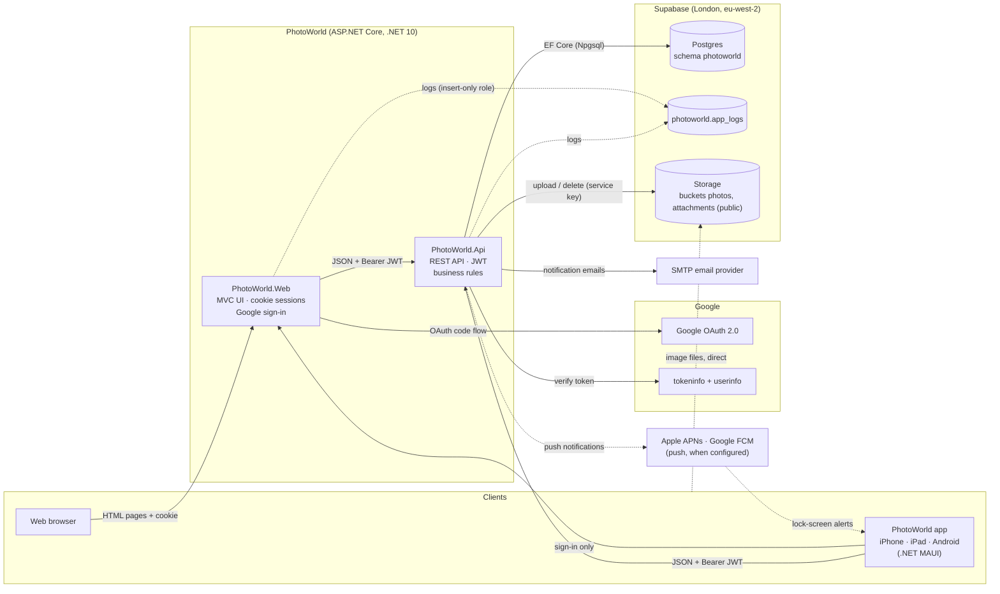

Map tiles and place search go straight from each client to its map provider (OpenStreetMap, Apple Maps or Google
Maps); see [Places and maps](#8-places-and-maps).

| Component | Role | Talks to |
|---|---|---|
| **PhotoWorld.Web** | Server-rendered MVC site. Owns the browser session (cookie) and the Google sign-in flow, for the website and for the app. Holds no database credentials except an insert-only logging role. | API (with the member's JWT), Google OAuth, `app_logs` |
| **PhotoWorld.Api** | The only component with database and storage write access. Verifies Google tokens (tokeninfo + userinfo), registers members, issues PhotoWorld JWTs, and enforces all rules (ownership, moderation, privacy, validation, HTML sanitizing, image processing). | Supabase Postgres + Storage, Google tokeninfo, `app_logs` |
| **PhotoWorld.App** | .NET MAUI app for iPhone, iPad and Android. Calls the API directly; uses the website only to sign in. | API, Web (sign-in), Supabase Storage (images), Apple/Google maps |
| **PhotoWorld.Shared** | Class library: DTOs, API routes, limits, provider names, claim types, the app sign-in hand-off, and the Supabase logger. | Used by Api and Web; its DTO/route sources are compiled into the App |
| **Supabase** | Managed Postgres (all data, in a dedicated `photoworld` schema), Storage (photo files, public bucket), `pg_cron` (log retention). | — |

Every arrow into the API carries a PhotoWorld **JWT**. The website and the app are both clients of the same API.

## 2. Projects in the solution

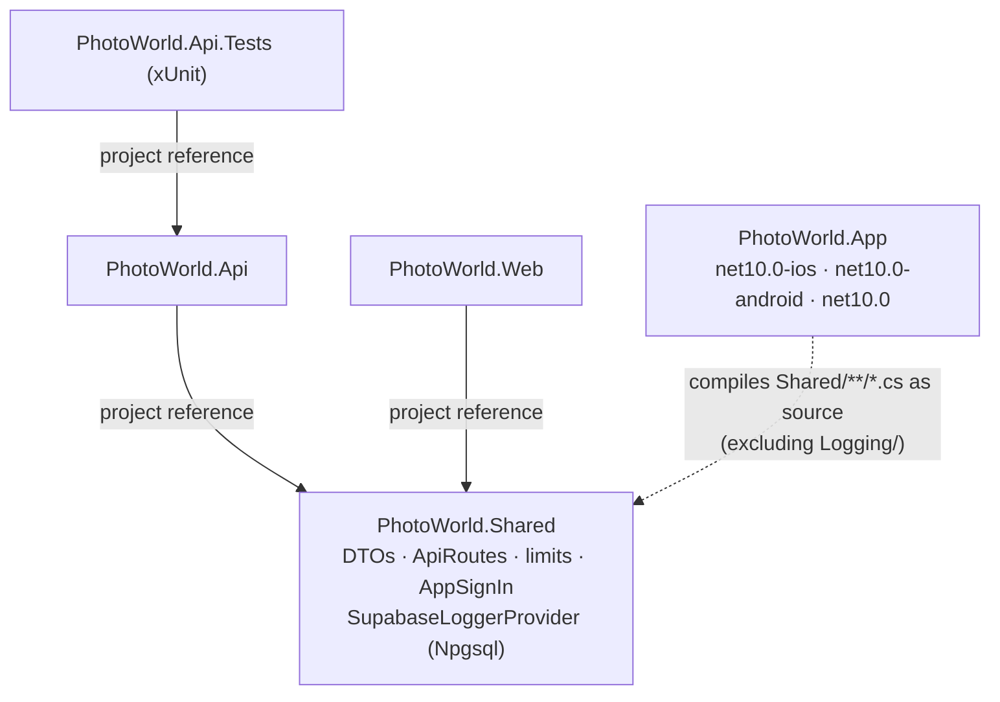

- `ApiRoutes` and the DTO records are shared, so the API controllers, the website's `PhotoWorldApiClient` and the
  app's `PhotoWorldApi` can't drift apart.
- The app links Shared's source instead of referencing the project, so it doesn't ship Npgsql (used only by the
  server-side logger).
- The app's platform targets are built only where their tools exist (`net10.0-ios`: Xcode on a Mac;
  `net10.0-android`: Android SDK + JDK). The plain `net10.0` target always compiles the shared C# and XAML.

| Project | Key folders |
|---|---|
| Api | `Controllers/` (Auth, Users, Photos, Feedback, Search, PhotoOfTheDay, Spots, Collections, Showcase, Blogs, BlogPosts, Places, Challenges, Activity, Devices, AdminUsers), `Data/` (EF entities, `PhotoWorldDbContext`, migrations), `Services/` (Identity, Photos, Blogs, Challenges, Activities, Push, Moderation, Notifications, JWT) |
| Web | `Controllers/`, `Views/`, `Services/PhotoWorldApiClient` (typed API client), `Authentication/`, `wwwroot/` (Bootstrap, Quill, Leaflet) |
| App | `Views/` (XAML pages), `ViewModels/` (CommunityToolkit.Mvvm), `Services/` (`AuthService`, `PhotoWorldApi`), `Platforms/iOS`, `Platforms/Android` |

## 3. Authentication

PhotoWorld has **one identity provider (Google)** and **one token format (a PhotoWorld JWT)**. Google tokens never
reach the API except once, at sign-in, to be verified; after that every component uses the PhotoWorld JWT.

| Token | Issued by | Lifetime | Held by | Used for |
|---|---|---|---|---|
| Google access token | Google | ~1 h | Web, briefly | Proving the Google identity to the API, once |
| PhotoWorld JWT (HS256) | API (`JwtTokenService`) | 8 h | Web (inside the auth cookie) or App (Keychain / Android Keystore) | Every API call (`Authorization: Bearer …`) |
| `PhotoWorld.Auth` cookie | Web | Same as the JWT inside it | Browser | The browser session |
| App one-time code | Web | 2 min, single use | App, briefly | Redeeming the JWT with the app's verifier |

### 3.1 Website sign-in

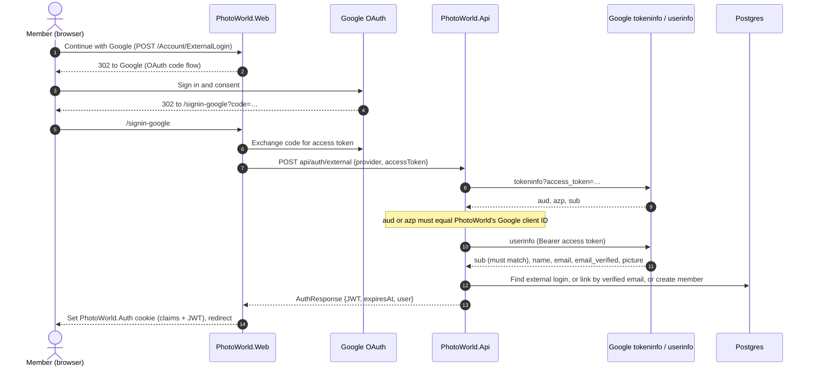

- First sign-in creates the account. A verified email already known from another provider links to the same member
  instead of creating a duplicate.
- The cookie expires with the JWT inside it, so a session never outlives its API token.

### 3.2 App sign-in (through the website)

The app has no Google client of its own. It signs in through the website in the system's secure browser sheet
(`ASWebAuthenticationSession` on iOS, a Chrome Custom Tab on Android) with a PKCE-style hand-off, so a malicious app
that catches the `photoworld://` redirect gets nothing usable.

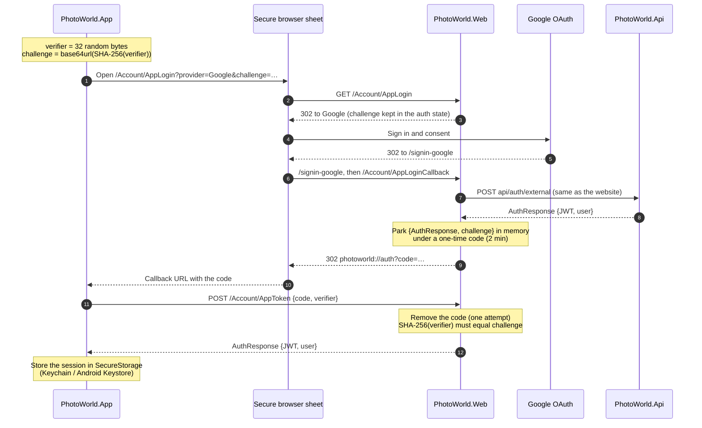

Implemented in `Shared/Auth/AppSignIn.cs` (tested against the RFC 7636 vector in `AppSignInTests`),
`Web/Controllers/AccountController.cs` and `App/Services/AuthService.cs`. Codes are kept in the Web's memory cache,
so run a single Web instance or move them to a shared cache.

### 3.3 Session end

- **Sign out:** the Web deletes its cookie; the app deletes its stored session.
- **Expiry or rejection:** any `401` from the API ends the session. The Web sends the member to sign in again
  (`ApiUnauthorizedFilter`); the app's `ApiAuthHandler` signs out and the shell returns to the sign-in page.
- **Account deletion** (Web settings or the app's Me tab): `DELETE api/users/me` removes the member and, through
  database cascades, everything they created; their photo and PDF files are then deleted from Storage.

## 4. A request, end to end

Every page and screen is a thin client over the API. Example: opening a photo.

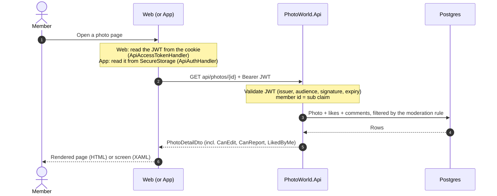

- **Authorization lives in the API.** Clients only hide buttons; the API decides (`CanEdit`, `CanReport`, owner
  checks, `404` for things you may not see).
- **The browser never calls the API directly.** It only talks to the Web (and loads images straight from Storage),
  so the JWT stays server-side inside the encrypted cookie.
- **Public endpoints:** only `api/auth/external` and `api/showcase` (home-page slideshow) work without a JWT. All
  website pages require sign-in except the home page, sign-in pages and the privacy policy.

## 5. Photos: upload, storage and display

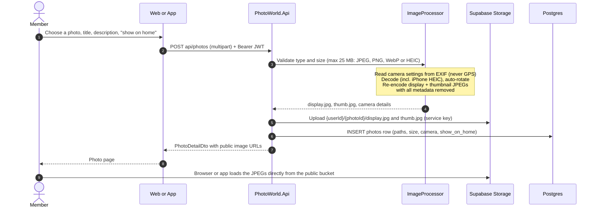

- **Several at once.** The website's *Upload several* page and the app's multi-select send the same `POST api/photos`
  once per photo, one after another, so each has its own result and a failure doesn't stop the rest.
- **Watermark and downloads.** With `watermark=true` the processor draws "© display name" (Open Sans, an embedded
  resource) on the display image only, before encoding; `photos.watermarked` records it. `photos.allow_download`
  (default true) is read by the clients: off hides the full-size link and *Share* from other members and blocks
  right-click and dragging on the website. It can't stop a determined copier, because the image is public.
- **Originals are never stored.** Only the two re-encoded JPEGs exist, without EXIF, so locations can't leak
  through the public bucket.
- The **API is the only writer** to Storage (with the Supabase service key). Clients receive public URLs.
- Deleting a photo deletes its row (likes, comments and reports cascade) and then its files. Deleting an account
  does the same for all of a member's photos.
- **Blog posts** embed photos as references (`data-photo-id`), not as uploads. The API's `BlogHtml` sanitizer keeps
  basic formatting, text colour, safe links and the author's own photos only, re-pointed at their real storage URLs.
- **Post PDFs** are real uploads: `POST api/blog-posts/{id}/attachments` (author only, checked by `%PDF-` header,
  5 per post, 20 MB each) stores them in the public `attachments` bucket; readers get `?download=` URLs.
  Deleting an attachment, its post or the account removes the row first, then the file.

## 6. Data model

All tables live in the `photoworld` schema (kept out of `public`, which Supabase's auto-generated Data API would
expose). Created by EF Core migrations; names are snake_case.

```mermaid
erDiagram
    users ||--o{ external_logins : "signs in with"
    users ||--o{ photos : owns
    users ||--o{ photo_likes : gives
    users ||--o{ photo_comments : writes
    users ||--o| blogs : "has settings"
    users ||--o{ blog_posts : writes
    users ||--o{ blog_comments : writes
    users ||--o{ places : "has been to"
    users ||--o| email_subscriptions : "gets emails"
    users ||--o{ reports : files
    users ||--o{ follows : "follows / is followed"
    users ||--o{ blocks : "blocks / is blocked"
    users ||--o{ activities : "is notified"
    users ||--o{ collections : curates
    users ||--o{ devices : "gets push on"
    users ||--o{ photo_feedback : gives
    photos ||--o{ photo_tags : "tagged"
    photos ||--o{ photo_feedback : receives
    photos ||--o{ photos_of_the_day : "featured on"
    collections ||--o{ collection_photos : holds
    photos ||--o{ collection_photos : "saved in"
    places |o--o{ photos : "where taken"
    photos ||--o{ challenge_entries : "entered as"
    challenges ||--o{ challenge_entries : has
    photos ||--o{ photo_likes : receives
    photos ||--o{ photo_comments : has
    photos ||--o{ blog_post_photos : "embedded in"
    blog_posts ||--o{ blog_post_photos : embeds
    blog_posts ||--o{ blog_attachments : attaches
    blog_posts ||--o{ blog_comments : has
    photos ||--o{ reports : "reported in"
    photos ||--o{ photo_view_days : "viewed on"
    users ||--o{ walks : organises
    walks ||--o{ walk_attendees : "joined by"
    users ||--o{ walk_attendees : joins
    photo_comments ||--o{ reports : "reported in"
    blog_posts ||--o{ reports : "reported in"
    blog_comments ||--o{ reports : "reported in"

    users {
        uuid id PK
        text display_name
        text email
        text avatar_url
        timestamptz created_at
        timestamptz last_login_at
    }
    external_logins {
        int id PK
        text provider
        text provider_user_id
        uuid user_id FK
    }
    photos {
        uuid id PK
        uuid owner_id FK
        text title
        text description
        text display_path
        text thumbnail_path
        int width
        int height
        text camera_make
        text camera_model
        text lens
        numeric focal_length_mm
        numeric aperture
        text exposure_time
        int iso
        timestamptz taken_at
        bool show_on_home
        bool allow_download
        bool watermarked
    }
    photo_view_days {
        uuid photo_id PK
        date day PK
        int views
    }
    walks {
        uuid id PK
        uuid organizer_id FK
        text title
        timestamptz starts_at
        timestamptz ends_at
        text meeting_point
        float latitude
        float longitude
        int max_people
        timestamptz cancelled_at
    }
    walk_attendees {
        uuid walk_id PK
        uuid user_id PK
        timestamptz joined_at
    }
    photo_likes {
        uuid photo_id PK
        uuid user_id PK
    }
    photo_comments {
        uuid id PK
        uuid photo_id FK
        uuid author_id FK
        text text
    }
    blogs {
        uuid user_id PK
        text title
        text intro
    }
    blog_posts {
        uuid id PK
        uuid author_id FK
        text title
        text body_html
        text excerpt
        uuid cover_photo_id FK
        text status
        timestamptz published_at
    }
    blog_post_photos {
        uuid post_id PK
        uuid photo_id PK
    }
    blog_attachments {
        uuid id PK
        uuid post_id FK
        text file_name
        bigint size_bytes
        text storage_path
    }
    blog_comments {
        uuid id PK
        uuid post_id FK
        uuid author_id FK
        text text
    }
    places {
        uuid id PK
        uuid user_id FK
        text name
        text note
        float latitude
        float longitude
        date visited_on
    }
    email_subscriptions {
        uuid user_id PK
        text email
        text frequency
        bool enabled
        timestamptz confirmed_at
        timestamptz notified_through
        timestamptz period_started_at
        bool weekly_summary
        timestamptz weekly_summary_from
    }
    follows {
        uuid follower_id PK
        uuid followee_id PK
        timestamptz created_at
    }
    blocks {
        uuid blocker_id PK
        uuid blocked_id PK
        timestamptz created_at
    }
    challenges {
        uuid id PK
        text title
        text description
        timestamptz starts_at
        timestamptz ends_at
    }
    challenge_entries {
        uuid challenge_id PK
        uuid photo_id PK
        timestamptz created_at
    }
    reports {
        uuid id PK
        uuid reporter_id FK
        uuid photo_id FK
        uuid comment_id FK
        uuid blog_post_id FK
        uuid blog_comment_id FK
        text reason
        text status
    }
```

Not shown: `app_logs` (see [Logging](#12-logging)), `__ef_migrations_history`, and the `open_reports` view. Every
member-owned row cascades on account deletion. A report targets exactly one item (`ck_reports_one_target`).

## 7. Moderation

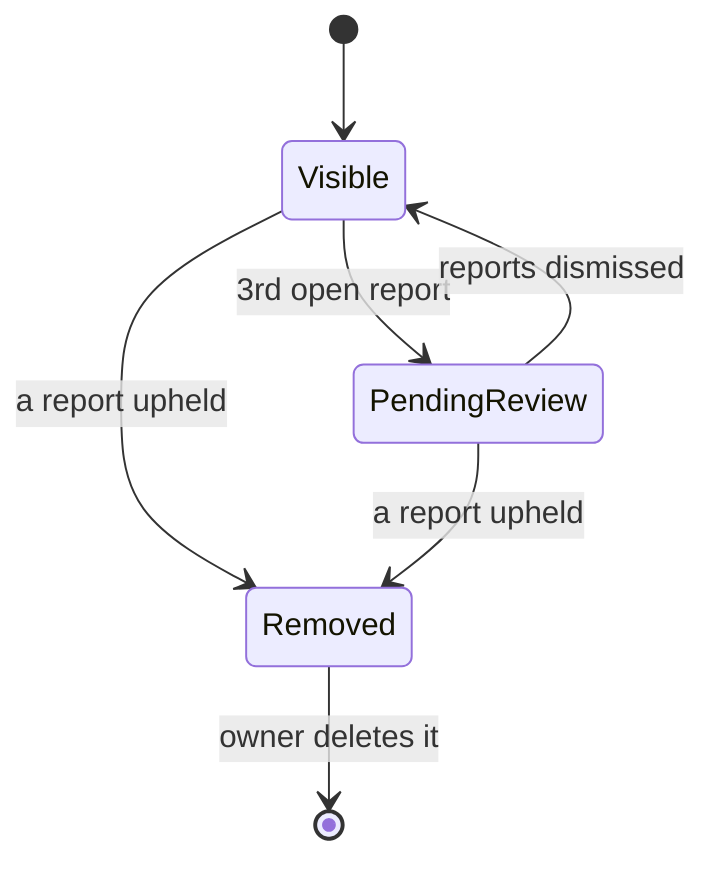

- Members report photos, comments, blog posts and blog comments (one report per member per item; not their own).
- At three open reports an item is hidden from everyone but its owner, who sees a "being reviewed" notice. One
  upheld report removes it for others. Dismissed reports don't count.
- The rule is a single expression (`Moderation.*VisibleTo`) that EF translates to SQL, applied to every query that
  lists or shows content. Moderators work in SQL against the `open_reports` view (see the README).
- **Suspended members** (`users.suspended_at`, set on the admin Users page) are hidden the same way, from everyone.
  The API's `SessionCheck` rejects their tokens (re-checked against the database, cached 30 s) and sign-in refuses
  them with the admin's reason. Admins are the members with `users.is_admin` (database only, never config).
- **Blocking** lives in the same expressions: content whose author the viewer blocked (`blocks`, via
  `users.BlockedBy`) is hidden from that viewer only. Blocking also removes follows both ways, and the API refuses
  follows and comments from a blocked member on the blocker's content. Blocks are private to the blocker.

## 8. Places and maps

Places are **private**: `api/places` only ever reads or writes the caller's own rows, and another member's place
answers `404`. The one way out is a member's choice: linking one of their places to a photo (`photos.place_id`,
checked to be their own) shows that place's name and position with the photo and on the Spots map (`api/spots`),
through the photo's visibility rule. Locations are entered by the member (search or a pin), never taken from photos.

| Client | Map | Search and suggested names |
|---|---|---|
| Website | Leaflet with OpenStreetMap tiles (browser) | Nominatim, from the browser, only when the member searches or clicks |
| iPhone / iPad | Apple Maps (MAUI Maps → MapKit) | Apple geocoder |
| Android | Google Maps SDK (needs `GoogleMapsApiKey`) | Android `Geocoder` |

The map providers receive tiles requests and search text from the member's device; nothing about the member's
account is sent. The privacy policy names each provider.

## 9. Community features

- **Following.** `POST`/`DELETE api/users/{id}/follow` adds or removes a `follows` row (not yourself:
  `ck_follows_not_self`). `following=true` on `GET api/photos` and `GET api/blog-posts` keeps only followed
  members' items; the website shows it as **Everyone / Following** tabs. Profiles show follower and following
  counts but not who they are.
- **Camera search.** `GET api/photos` also takes `camera`, `lens`, `focalMin/Max`, `apertureMin/Max` and
  `isoMin/Max` (`PhotoSearch` in Shared). `PhotoFilters.Matching` applies them; text is a case-insensitive
  "contains" with the member's text escaped, and photos without a setting never match a filter on it.
  `GET api/photos/camera-options` suggests the 100 most used cameras and lenses. The camera details on a photo
  page link to the matching gallery filter.
- **Challenges.** A `challenges` row is a theme open from `starts_at` until `ends_at`, created by admins on the
  website's Admin → Challenges page. Members enter up to 3 of their own visible photos while it's open
  (`challenge_entries`) and can withdraw them until it ends. **Votes are likes** from other members between the
  moment of entry and `ends_at`, so no separate voting system exists and likes after the end don't move anything.
  `ChallengeStandings` ranks entries by votes, then the earlier entry; the leader of a closed challenge is its
  winner. Standings are computed when read, not stored: entries hidden by moderation drop out (shown only to their
  owner, unranked), and deleting a photo removes its entry. Wins show as trophies on the member page.
- **Activity.** Controllers call `ActivityFeed` after likes, comments, feedback, follows, uploads and first
  publication; `ScheduledActivitySender` adds challenge news and the photo-of-the-day notice. Rows in `activities` cascade with their recipient, actor, photo,
  post or challenge; reading filters them through the same visibility rule, so hidden or blocked content never shows.
- **Collections** (`collections`, `collection_photos`) hold any visible photos; `Moderation.CollectionVisibleTo`
  shows a member their own and others' public ones (not suspended or blocked owners), and photos inside go through
  `PhotoVisibleTo`. **Spots**: `photos.place_id` links a photo to one of its owner's places (see Places and maps).
- **Tags and search.** `photo_tags` holds normalised tags (`PhotoTags` in Shared: lower case, no `#`, up to 10,
  from the tags field plus `#hashtags` in the description). `PhotoSearch` gained `text` (title, description or
  tag), `tag` and `wantsFeedback`, so tag pages and "see all" are just gallery filters. `GET api/search` returns
  members, tags, photos and posts; `GET api/explore` returns trending tags (last 7 days), popular photos from members
  the viewer doesn't follow (last 14 days) and suggested members. All of it goes through the visibility rules.
- **Photo of the day.** `photos_of_the_day` has one row per UTC date (admins set it from a photo's page; schedule on
  Admin → Photo of the day). `GET api/photo-of-the-day` returns today's, or the latest within a week; only photos
  visible to everyone can be picked. The owner is notified on the day.
- **Feedback.** `photos.wants_feedback` opens a photo to `photo_feedback` (one row per member: composition, light,
  focus 1–5 and a comment). `GET api/photos/{id}/feedback` gives the owner everything plus averages, a giver their
  own, everyone else only the count.
- **Photo walks.** `walks` (organiser, plan, time, meeting point, optional people limit, `cancelled_at`) and
  `walk_attendees`. `WalkRules` holds the checks (length ≤ 12 h, joining before the start, not full, not blocked);
  `WalksController.Visible` applies suspension and blocks both ways. Followers get `walk_new`, attendees
  `walk_changed`/`walk_cancelled`, and `ScheduledActivitySender` sends `walk_reminder` within 24 h of the start.
  Photos join a walk through its tag, `walk-` plus the first 8 hex characters of its id.
- **Insights.** `GET api/photos/{id}` adds one to `photo_view_days` (an upsert per photo per UTC day) when the
  caller isn't the owner; the viewer is not recorded and a failure never blocks the photo. `GET api/users/me/insights`
  returns the last 30 days and the 30 before (views, likes, new followers, comments), per-day views and likes, the
  top 5 photos and the top 8 tags by likes. The website draws two SVG column charts (one measure each, never two
  scales on one plot); the app draws the same with `GraphicsView`.
- **In the app** the same API calls back the Gallery's Everyone / Following switch, Filter page and challenge
  banner, the Blogs switch, a member page (follow, trophies, photos) and the challenge, entries and "enter a
  photo" pages. Challenge wording (`ChallengeDisplay`) lives in Shared so the website and app read the same.

## 10. Email notifications

Members choose an address and a frequency (instant, daily or weekly) in the website's settings or the app. A
background service in the API does the sending through SMTP.

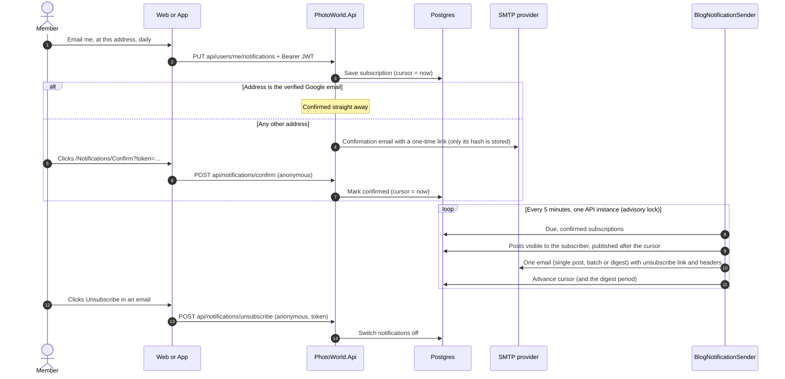

- Data: one `email_subscriptions` row per member (address, frequency, on/off, confirmed, cursor, digest period,
  weekly summary on/off and its period, unsubscribe token); it cascades on account deletion.
- **Weekly summary.** `WeeklySummarySender` (same schedule, its own advisory lock) emails members who switched it
  on, once 7 days have passed since `weekly_summary_from`: views, likes, comments, feedback and new followers on their
  photos, walks in the coming week from people they follow, and open challenges. A quiet week sends nothing; the
  period moves on either way, and a failed send is retried. The unsubscribe link switches off both kinds of email.
- Only posts the subscriber could see on the site are sent: published, not hidden by moderation, not their own.
- No SMTP host configured (development): emails are written as `.eml` files to `src/PhotoWorld.Api/emails/`.

## 11. Push notifications

The server side is in place and **switched off until keys are configured**; the app registers for push once an
Apple push key and a Firebase project exist (README → Push notifications).

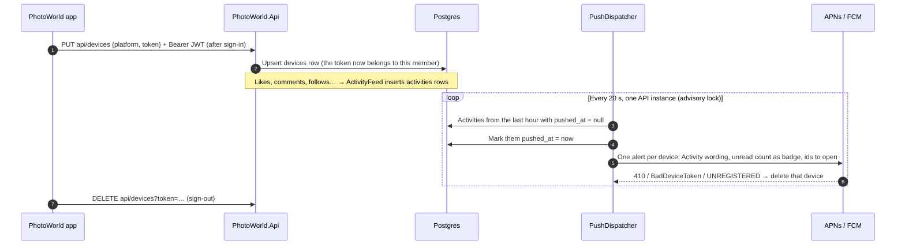

- **APNs**: HTTP/2 to `api.push.apple.com` (or the sandbox), authenticated with an ES256 provider token signed by the
  `.p8` key and reused for 50 minutes. **FCM**: HTTP v1 `messages:send`, with an OAuth token from the service-account
  key (RS256 assertion), cached until it expires. Both are in `Services/Push`; the payloads and tokens are unit-tested.
- Members with "Also send them to my phone" switched off (`activity_settings.push`), suspended members and anyone
  without a registered phone just get their items marked as handled.

## 12. Logging

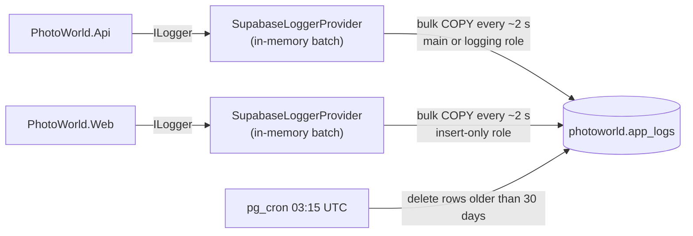

- Both apps log through the same provider (in Shared), tagged `PhotoWorld.Api` / `PhotoWorld.Web`. Logging never
  blocks a request; if Supabase is unreachable a batch is dropped and a line goes to stderr.
- The Web holds only the insert-only `photoworld_logger` role, never the main database password.
- The mobile app logs to the device console only (Debug builds).

## 13. Build, CI and database migrations

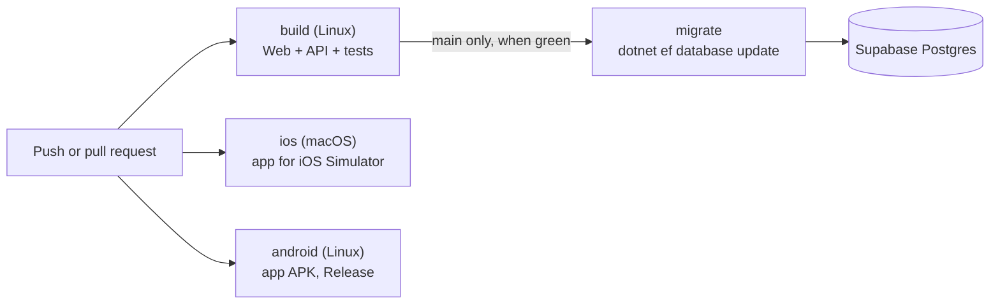

- [`.github/workflows/ci.yml`](../.github/workflows/ci.yml) runs four jobs. `migrate` needs the
  `SUPABASE_DB_CONNECTION_STRING` repository secret.
- **Migrations are never applied at startup**, so several API instances can't race. The API logs a warning if the
  database is behind. `docs/supabase-schema.sql` is the same schema as an idempotent script.
- Deployment of the API and Web, and publishing the app to the App Store / Google Play, aren't automated yet (see the
  README checklists).

## 14. Configuration and secrets

Secrets are never in `appsettings.json`: user-secrets in development, environment variables / a secret store in
production, a git-ignored `Local.props` for the app.

| Setting | Where | Used by | Purpose |
|---|---|---|---|
| `ConnectionStrings:PhotoWorld` | API user-secrets | API, CI (`migrate`) | Supabase Postgres (session pooler) |
| `ConnectionStrings:Logging` | Web (and optionally API) user-secrets | Web, API | Insert-only logging role |
| `Supabase:SecretKey`, `Supabase:Url` | API user-secrets / settings | API | Storage uploads and deletes |
| `Jwt:SigningKey` (+ issuer, audience, lifetime) | API user-secrets / `appsettings.json` | API | Signing and validating PhotoWorld JWTs |
| `Authentication:Google:ClientId` / `ClientSecret` | Web user-secrets (ID also in API) | Web, API | Google OAuth; the API checks `aud` |
| `PhotoWorldApi:BaseUrl` | Web `appsettings.json` | Web | Where the API is |
| `Site:ContactEmail` | Web `appsettings.json` | Web | Privacy policy contact |
| `AppConfig.ApiBaseUrl` / `WebBaseUrl` | `App/AppConfig.cs` | App | API and sign-in URLs (Debug: localhost) |
| `GoogleMapsApiKey`, `JavaSdkDirectory` | `App/Local.props` (git-ignored) | App (Android) | Places map key; local JDK |
| `Email:Smtp:*`, `Email:From` | API user-secrets | API | Sending notification emails (none set: `.eml` files) |
| `Email:WebBaseUrl`, `Email:PollMinutes` | API `appsettings*.json` | API | Links in emails; how often the sender runs |
| `Push:Apns:TeamId`, `KeyId`, `BundleId`, `PrivateKey`, `UseSandbox` | API user-secrets | API | iPhone push (off when unset) |
| `Push:Fcm:ServiceAccountJson` | API user-secrets | API | Android push (off when unset) |

## 15. Design decisions

| Decision | Why |
|---|---|
| UI and API as separate apps | The website and the mobile app share one API, and only the API holds database credentials. |
| Google tokens verified by the API, then a PhotoWorld JWT | One token format for all clients; the API never trusts a client's claim about who the member is. |
| JWT kept server-side in the Web's cookie | The browser never sees an API token, so scripts can't steal one. |
| App signs in through the website (PKCE-style) | No separate mobile Google client or API change; intercepted redirects are useless. |
| Dedicated `photoworld` schema | Supabase's auto-generated Data API exposes `public`; this data is only reachable through the API. |
| Photos re-encoded, originals discarded | Strips GPS and other metadata before files reach a public bucket. |
| Moderation as one shared expression | The same visibility rule in every query, translated to SQL. |
| Challenge votes are likes, standings computed on read | No second voting system to build or abuse, no background job, and moderation or deletions are reflected straight away. |
| Admins in the database (`users.is_admin`) | Managed from the Users page without redeploying; nobody can demote or suspend themselves, so there's always an admin. |
| Push from the activity table, not from each action | One sender with one rule set (settings, blocks, suspension) and a single place to retry; actions stay fast. |
| Tags as rows, search with `lower(...) LIKE` | Simple, exact tag pages with an index; fine at PhotoWorld's size. Postgres full-text search is the next step if it grows. |
| Places private by route design | There is no route that takes another member's id, so there's nothing to get wrong. |
| Migrations by CI, not at startup | Safe with several API instances; schema changes are deliberate. |
| DTOs and routes in Shared | API, website and app compile against the same contract. |
