# PhotoWorld architecture

How the pieces of PhotoWorld fit together: the website, the API, the iPhone/iPad/Android app, the Supabase
database and storage, Google sign-in, the map services and the weather forecast. For setup and day-to-day commands see the
[README](../README.md), which also has [screenshots](../README.md#what-it-looks-like) of the website and the app.

- [1. System overview](#1-system-overview)
- [2. Projects in the solution](#2-projects-in-the-solution)
- [3. Authentication](#3-authentication)
- [4. A request, end to end](#4-a-request-end-to-end)
- [5. Photos: upload, storage and display](#5-photos-upload-storage-and-display)
- [6. Data model](#6-data-model)
- [7. Moderation](#7-moderation)
- [8. Places and maps](#8-places-and-maps)
- [9. Community features](#9-community-features)
- [10. Email notifications](#10-email-notifications)
- [11. Push notifications](#11-push-notifications)
- [12. Logging](#12-logging)
- [13. Build, CI and database migrations](#13-build-ci-and-database-migrations)
- [14. Configuration and secrets](#14-configuration-and-secrets)
- [15. Design decisions](#15-design-decisions)

## 1. System overview

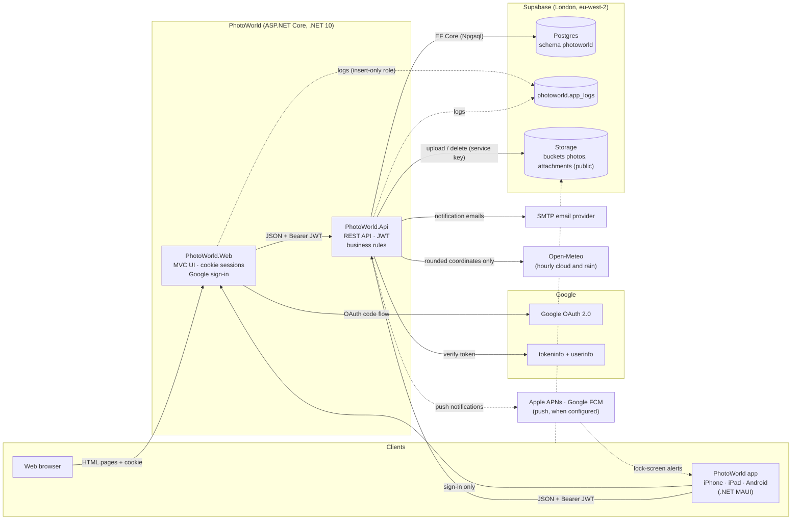

Map tiles and place search go straight from each client to its map provider (OpenStreetMap, Apple Maps or Google
Maps); see [Places and maps](#8-places-and-maps).

| Component | Role | Talks to |
|---|---|---|
| **PhotoWorld.Web** | Server-rendered MVC site. Owns the browser session (cookie) and the Google sign-in flow, for the website and for the app. Holds no database credentials except an insert-only logging role. | API (with the member's JWT), Google OAuth, `app_logs` |
| **PhotoWorld.Api** | The only component with database and storage write access. Verifies Google tokens (tokeninfo + userinfo), registers members, issues PhotoWorld JWTs, and enforces all rules (ownership, moderation, privacy, validation, HTML sanitizing, image processing). Fetches weather forecasts for light forecasts. | Supabase Postgres + Storage, Google tokeninfo, Open-Meteo, `app_logs` |
| **PhotoWorld.App** | .NET MAUI app for iPhone, iPad and Android. Calls the API directly; uses the website only to sign in. | API, Web (sign-in), Supabase Storage (images), Apple/Google maps |
| **PhotoWorld.Shared** | Class library: DTOs, API routes, limits, provider names, claim types, the app sign-in hand-off, and the Supabase logger. | Used by Api and Web; its DTO/route sources are compiled into the App |
| **Supabase** | Managed Postgres (all data, in a dedicated `photoworld` schema), Storage (photo files, public bucket), `pg_cron` (log retention). | — |

Every arrow into the API carries a PhotoWorld **JWT**. The website and the app are both clients of the same API.

## 2. Projects in the solution

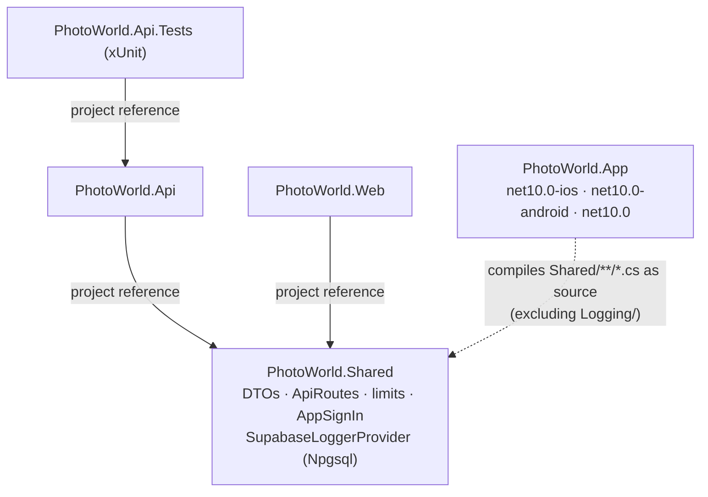

- `ApiRoutes` and the DTO records are shared, so the API controllers, the website's `PhotoWorldApiClient` and the
  app's `PhotoWorldApi` can't drift apart.
- The app links Shared's source instead of referencing the project, so it doesn't ship Npgsql (used only by the
  server-side logger).
- The app's platform targets are built only where their tools exist (`net10.0-ios`: Xcode on a Mac;
  `net10.0-android`: Android SDK + JDK). The plain `net10.0` target always compiles the shared C# and XAML.
- In Development the API publishes an OpenAPI document (`Microsoft.AspNetCore.OpenApi`, `/openapi/v1.json`) and a
  Scalar API reference (`Scalar.AspNetCore`, `/scalar`). `BearerSecuritySchemeTransformer` adds the `Bearer` (JWT)
  security scheme to the document, so requests from Scalar can carry a PhotoWorld JWT. Neither is mapped in production.

| Project | Key folders |
|---|---|
| Api | `Controllers/` (Auth, Users, Photos, Feedback, Search, PhotoOfTheDay, Spots, Collections, Showcase, Blogs, BlogPosts, Places, Clubs, Challenges, Walks, Activity, Devices, AdminUsers), `Data/` (EF entities, `PhotoWorldDbContext`, migrations), `Services/` (Identity, Photos, Blogs, Challenges, Clubs, Places, Activities, Push, Moderation, Notifications, JWT) |
| Web | `Controllers/`, `Views/`, `Services/PhotoWorldApiClient` (typed API client), `Authentication/`, `wwwroot/` (Bootstrap, Quill, Leaflet) |
| App | `Views/` (XAML pages), `ViewModels/` (CommunityToolkit.Mvvm), `Services/` (`AuthService`, `PhotoWorldApi`), `Platforms/iOS`, `Platforms/Android` |

## 3. Authentication

PhotoWorld has **two identity providers (Google and Apple)** and **one token format (a PhotoWorld JWT)**. Provider
tokens never reach the API except once, at sign-in, to be verified; after that every component uses the PhotoWorld
JWT. Each provider is an `IExternalIdentityVerifier` in the API and an authentication scheme in the Web, registered
only when its client ID is configured.

| Token | Issued by | Lifetime | Held by | Used for |
|---|---|---|---|---|
| Google access token | Google | ~1 h | Web, briefly | Proving the Google identity to the API, once |
| Apple ID token (JWT) | Apple | 10 min | Web, briefly | Proving the Apple identity to the API, once |
| Apple refresh token | Apple | Until revoked | API (`external_logins.refresh_token`) | Only revoking the sign-in when the account is deleted |
| PhotoWorld JWT (HS256) | API (`JwtTokenService`) | 8 h | Web (inside the auth cookie) or App (Keychain / Android Keystore) | Every API call (`Authorization: Bearer …`) |
| `PhotoWorld.Auth` cookie | Web | Same as the JWT inside it | Browser | The browser session |
| App one-time code | Web | 2 min, single use | App, briefly | Redeeming the JWT with the app's verifier |

### 3.1 Website sign-in

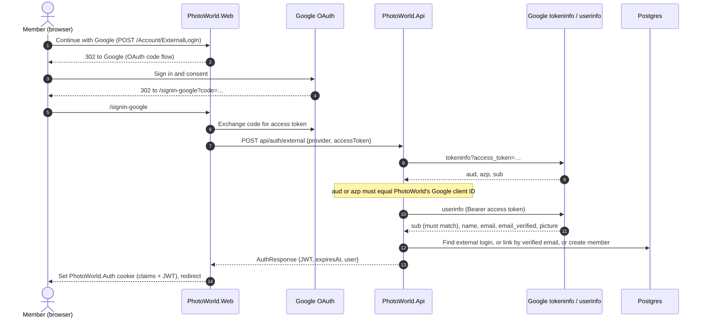

- First sign-in creates the account. A verified email already known from another provider (compared without
  capitals) links to the same member instead of creating a duplicate.
- **Apple** ("Sign in with Apple") uses the OpenID Connect handler on `/signin-apple` with `response_mode=form_post`
  (so the correlation and nonce cookies are `SameSite=None`). There's no fixed client secret: `AppleClientSecret`
  (Shared) signs a 5-minute ES256 JWT with the team's `.p8` key for each code exchange. The Web sends the **ID token**
  to the API, plus the name Apple posts only on first sign-in and the refresh token. `AppleIdentityVerifier` checks
  the token against Apple's published keys (issuer `https://appleid.apple.com`, audience = the Services ID, expiry);
  the name is only used to create a new member. Deleting the account calls Apple's `auth/revoke` with the stored
  refresh token (`AppleTokenRevoker`), as Apple requires. Apple shares no picture, and may share a private relay email.
- The cookie expires with the JWT inside it, so a session never outlives its API token.

### 3.2 App sign-in (through the website)

The app has no Google client of its own. It signs in through the website in the system's secure browser sheet
(`ASWebAuthenticationSession` on iOS, a Chrome Custom Tab on Android) with a PKCE-style hand-off, so a malicious app
that catches the `photoworld://` redirect gets nothing usable.

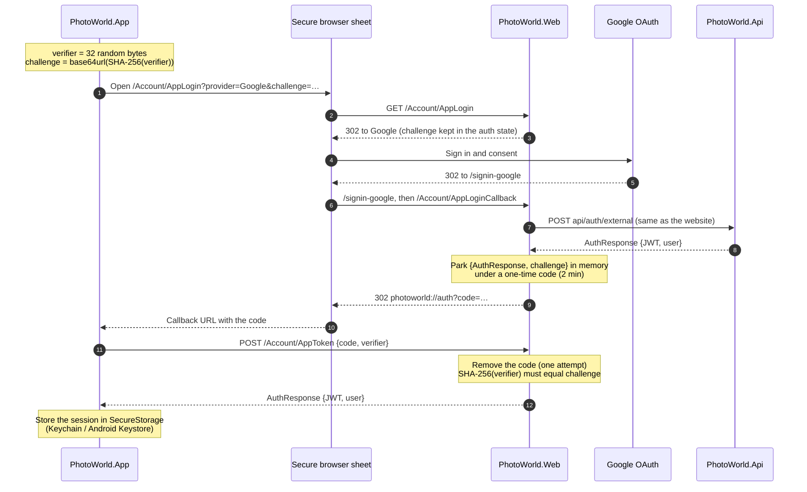

Implemented in `Shared/Auth/AppSignIn.cs` (tested against the RFC 7636 vector in `AppSignInTests`),
`Web/Controllers/AccountController.cs` and `App/Services/AuthService.cs`. Codes are kept in the Web's memory cache,
so run a single Web instance or move them to a shared cache.

### 3.3 Session end

- **Sign out:** the Web deletes its cookie; the app deletes its stored session.
- **Expiry or rejection:** any `401` from the API ends the session. The Web sends the member to sign in again
  (`ApiUnauthorizedFilter`); the app's `ApiAuthHandler` signs out and the shell returns to the sign-in page.
- **Account deletion** (Settings on the website, or Me → Settings in the app): `DELETE api/users/me` removes the member and, through
  database cascades, everything they created; their photo and PDF files are then deleted from Storage.

## 4. A request, end to end

Every page and screen is a thin client over the API. Example: opening a photo.

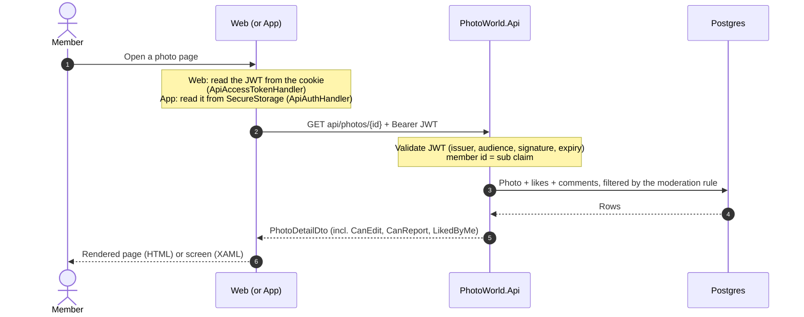

- **Authorization lives in the API.** Clients only hide buttons; the API decides (`CanEdit`, `CanReport`, owner
  checks, `404` for things you may not see).
- **The browser never calls the API directly.** It only talks to the Web (and loads images straight from Storage),
  so the JWT stays server-side inside the encrypted cookie.
- **Public endpoints:** only `api/auth/external` and `api/showcase` (home-page slideshow) work without a JWT. All
  website pages require sign-in except the home page, sign-in pages and the privacy policy.

## 5. Photos: upload, storage and display

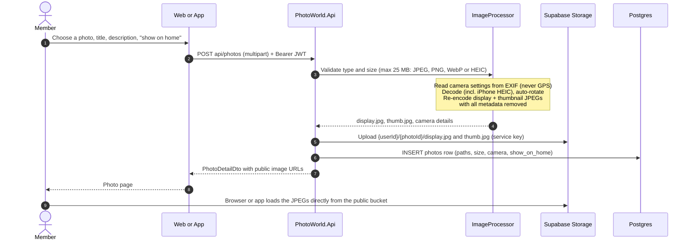

- **Several at once.** The website's *Upload several* page and the app's multi-select send the same `POST api/photos`
  once per photo, one after another, so each has its own result and a failure doesn't stop the rest.
- **Watermark and downloads.** With `watermark=true` the processor draws "© display name" (Open Sans, an embedded
  resource) on the display image only, before encoding; `photos.watermarked` records it. `photos.allow_download`
  (default true) is read by the clients: off hides the full-size link and *Share* from other members and blocks
  right-click and dragging on the website. It can't stop a determined copier, because the image is public.
- **Originals are never stored.** Only the two re-encoded JPEGs exist, without EXIF, so locations can't leak
  through the public bucket.
- The **API is the only writer** to Storage (with the Supabase service key). Clients receive public URLs.
- **Thumbnail URLs** come from `SupabaseStorage.ThumbnailUrl`. By default it's the stored `thumb.jpg`. With
  `Supabase:ImageTransforms` on (Supabase Pro or higher; Free has no transforms), it's Supabase's resize endpoint
  (`/storage/v1/render/image/public/…`, 640 px box) and new uploads store only the display image, with
  `thumbnail_path` pointing at it. Every photo works either way, so the setting can be switched back. Display
  images and blog covers are never transformed.
- **Sharing to clubs** happens after the upload: the website's form and the app send `PUT
  api/clubs/{id}/photos/{photoId}` for each club ticked (see [Community features](#9-community-features)).
- Deleting a photo deletes its row (likes, comments and reports cascade) and then its files. Deleting an account
  does the same for all of a member's photos.
- **Blog posts** embed photos as references (`data-photo-id`), not as uploads. The API's `BlogHtml` sanitizer keeps
  basic formatting, text colour, safe links and the author's own photos only, re-pointed at their real storage URLs.
- **Post PDFs** are real uploads: `POST api/blog-posts/{id}/attachments` (author only, checked by `%PDF-` header,
  5 per post, 20 MB each) stores them in the public `attachments` bucket; readers get `?download=` URLs.
  Deleting an attachment, its post or the account removes the row first, then the file.

## 6. Data model

All tables live in the `photoworld` schema (kept out of `public`, which Supabase's auto-generated Data API would
expose). Created by EF Core migrations; names are snake_case.

```mermaid
erDiagram
    users ||--o{ external_logins : "signs in with"
    users ||--o{ photos : owns
    users ||--o{ photo_likes : gives
    users ||--o{ photo_comments : writes
    users ||--o| blogs : "has settings"
    users ||--o| portfolios : "may share"
    portfolios ||--o{ portfolio_photos : shows
    photos ||--o{ portfolio_photos : "chosen in"
    users ||--o{ blog_posts : writes
    users ||--o{ blog_comments : writes
    users ||--o{ places : "has been to"
    users ||--o| email_subscriptions : "gets emails"
    users ||--o{ reports : files
    users ||--o{ follows : "follows / is followed"
    users ||--o{ blocks : "blocks / is blocked"
    users ||--o{ activities : "is notified"
    users ||--o{ collections : curates
    users ||--o{ devices : "gets push on"
    users ||--o{ photo_feedback : gives
    photos ||--o{ photo_tags : "tagged"
    photos ||--o{ photo_feedback : receives
    photos ||--o{ photos_of_the_day : "featured on"
    collections ||--o{ collection_photos : holds
    photos ||--o{ collection_photos : "saved in"
    places |o--o{ photos : "where taken"
    photos ||--o{ challenge_entries : "entered as"
    challenges ||--o{ challenge_entries : has
    photos ||--o{ photo_likes : receives
    photos ||--o{ photo_comments : has
    photos ||--o{ blog_post_photos : "embedded in"
    blog_posts ||--o{ blog_post_photos : embeds
    blog_posts ||--o{ blog_attachments : attaches
    blog_posts ||--o{ blog_comments : has
    photos ||--o{ reports : "reported in"
    photos ||--o{ photo_view_days : "viewed on"
    users ||--o{ walks : organises
    walks ||--o{ walk_attendees : "joined by"
    users ||--o{ walk_attendees : joins
    photo_comments ||--o{ reports : "reported in"
    blog_posts ||--o{ reports : "reported in"
    blog_comments ||--o{ reports : "reported in"
    places ||--o{ place_forecast_notices : "alerted for"
    users ||--o{ clubs : owns
    clubs ||--o{ club_members : has
    users ||--o{ club_members : "belongs to"
    clubs ||--o{ club_photos : "feed of"
    photos ||--o{ club_photos : "shared to"
    clubs |o--o{ walks : "members-only"
    clubs |o--o{ challenges : runs
    clubs ||--o{ reports : "reported in"

    users {
        uuid id PK
        text display_name
        text email
        text avatar_url
        timestamptz created_at
        timestamptz last_login_at
    }
    external_logins {
        int id PK
        text provider
        text provider_user_id
        uuid user_id FK
    }
    photos {
        uuid id PK
        uuid owner_id FK
        text title
        text description
        text display_path
        text thumbnail_path
        int width
        int height
        text camera_make
        text camera_model
        text lens
        numeric focal_length_mm
        numeric aperture
        text exposure_time
        int iso
        timestamptz taken_at
        text review_status
        timestamptz reviewed_at
        text review_note
        bool show_on_home
        bool allow_download
        bool watermarked
        text before_display_path
    }
    portfolios {
        uuid user_id PK
        text slug UK
        bool is_public
        text bio
        text website
        text instagram
        text contact_email
    }
    portfolio_photos {
        uuid user_id PK
        uuid photo_id PK
        int position
    }
    photo_view_days {
        uuid photo_id PK
        date day PK
        int views
    }
    walks {
        uuid id PK
        uuid organizer_id FK
        text title
        timestamptz starts_at
        timestamptz ends_at
        text meeting_point
        float latitude
        float longitude
        int max_people
        timestamptz cancelled_at
        uuid club_id FK
    }
    clubs {
        uuid id PK
        uuid owner_id FK
        text name
        text description
        text city
        float latitude
        float longitude
        text join_policy
        uuid cover_photo_id FK
        text review_status
        text review_note
    }
    club_members {
        uuid club_id PK
        uuid user_id PK
        text role
        text status
        timestamptz joined_at
    }
    club_photos {
        uuid club_id PK
        uuid photo_id PK
        timestamptz shared_at
    }
    place_forecast_notices {
        uuid place_id PK
        date date PK
        timestamptz sent_at
    }
    walk_attendees {
        uuid walk_id PK
        uuid user_id PK
        timestamptz joined_at
    }
    photo_likes {
        uuid photo_id PK
        uuid user_id PK
    }
    photo_comments {
        uuid id PK
        uuid photo_id FK
        uuid author_id FK
        text text
    }
    blogs {
        uuid user_id PK
        text title
        text intro
    }
    blog_posts {
        uuid id PK
        uuid author_id FK
        text title
        text body_html
        text excerpt
        uuid cover_photo_id FK
        text status
        timestamptz published_at
        timestamptz reviewed_at
        text review_note
    }
    blog_post_photos {
        uuid post_id PK
        uuid photo_id PK
    }
    blog_attachments {
        uuid id PK
        uuid post_id FK
        text file_name
        bigint size_bytes
        text storage_path
    }
    blog_comments {
        uuid id PK
        uuid post_id FK
        uuid author_id FK
        text text
    }
    places {
        uuid id PK
        uuid user_id FK
        text name
        text note
        float latitude
        float longitude
        date visited_on
        bool forecast_alerts
    }
    email_subscriptions {
        uuid user_id PK
        text email
        text frequency
        bool enabled
        timestamptz confirmed_at
        timestamptz notified_through
        timestamptz period_started_at
        bool weekly_summary
        timestamptz weekly_summary_from
    }
    follows {
        uuid follower_id PK
        uuid followee_id PK
        timestamptz created_at
    }
    blocks {
        uuid blocker_id PK
        uuid blocked_id PK
        timestamptz created_at
    }
    challenges {
        uuid id PK
        text title
        text description
        timestamptz starts_at
        timestamptz ends_at
        uuid club_id FK
    }
    challenge_entries {
        uuid challenge_id PK
        uuid photo_id PK
        timestamptz created_at
    }
    reports {
        uuid id PK
        uuid reporter_id FK
        uuid photo_id FK
        uuid comment_id FK
        uuid blog_post_id FK
        uuid blog_comment_id FK
        uuid club_id FK
        text reason
        text status
    }
```

Not shown: `app_logs` (see [Logging](#12-logging)), `__ef_migrations_history`, `activities`, `activity_settings`,
and the `open_reports` view. Every member-owned row cascades on account deletion; a club goes with its owner's
account (unless handed over first), and its members, photo shares, walks and challenges go with it. A report
targets exactly one item (`ck_reports_one_target`). `club_members` allows one owner per club (a filtered unique
index), and `activities.club_id` links club activity to its club.

## 7. Moderation

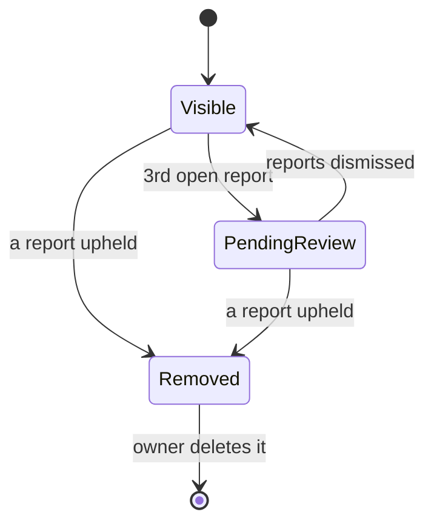

- Members report photos, comments, blog posts, blog comments and clubs (one report per member per item; not their
  own).
- At three open reports an item is hidden from everyone but its owner, who sees a "being reviewed" notice. One
  upheld report removes it for others. Dismissed reports don't count.
- The rule is a single expression (`Moderation.*VisibleTo`) that EF translates to SQL, applied to every query that
  lists or shows content. Moderators work in SQL against the `open_reports` view (see the README).
- **Suspended members** (`users.suspended_at`, set on the admin Users page) are hidden the same way, from everyone.
  The API's `SessionCheck` rejects their tokens (re-checked against the database, cached 30 s) and sign-in refuses
  them with the admin's reason. Admins are the members with `users.is_admin` (database only, never config).
- **Blocking** lives in the same expressions: content whose author the viewer blocked (`blocks`, via
  `users.BlockedBy`) is hidden from that viewer only. Blocking also removes follows both ways, and the API refuses
  follows and comments from a blocked member on the blocker's content. Blocks are private to the blocker.
- **Blog post approval** happens before publication, on top of the report-based rules above:

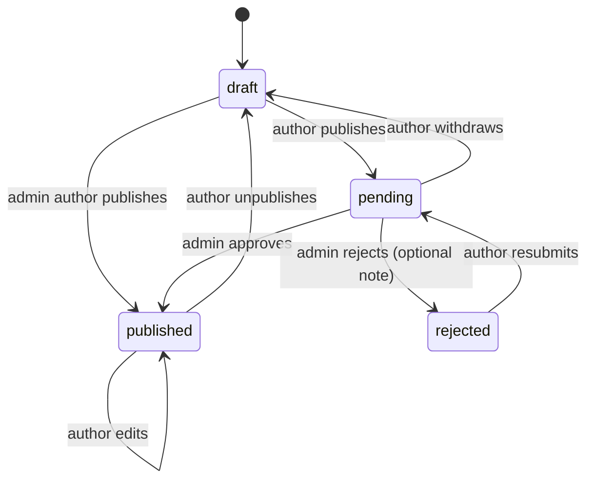

  `BlogReview.StatusAfterSave` (pure, tested) decides the status when an author saves. Only `published` posts are
  visible to others; `Moderation.PostVisibleTo(userId, reviewer: true)` also shows `pending` posts to admins, so
  they can read one on the normal post page. `POST api/admin/blog-posts/{id}/approve` and `…/reject` (admins only,
  `409` unless the post is pending) set `reviewed_at` (and `review_note` on rejection, shown to the author only),
  and notify the author (`post_approved` / `post_rejected`, always sent). Approval also stamps `published_at`, so
  followers' `new_post` activity and the email digests go out at approval, not at submission.
  `GET api/admin/blog-posts/pending` lists the queue, oldest first, without suspended members' posts.
- **Photo approval** works the same way with `photos.review_status` (`pending` → `approved` or `rejected`;
  `PhotoReview` holds the rules). Uploads by members start `pending`, admins' uploads `approved`; existing rows
  defaulted to `approved` in the migration. `Moderation.PhotoVisibleTo` requires `approved` for everyone but the
  owner (and, with `reviewer: true`, admins for `pending`), so every list, map, search, challenge standing, showcase
  and blog embed leaves unapproved photos out with no change of its own. `GET api/admin/photos/pending` (oldest
  first) skips photos in a pending blog post or used as its cover; approving that post approves them, with no
  separate notification. `POST api/admin/photos/approve` takes a list of ids (a page of the queue) and notifies each
  owner (`photo_approved`) and their followers (`new_photo`, which an upload by a member no longer sends);
  `POST api/admin/photos/{id}/reject` stores the note and sends `photo_rejected`. The image files are in the public
  bucket from upload, as before: approval decides where PhotoWorld shows a photo, not who can fetch its URL.
- **Club approval** follows the photo pattern with `clubs.review_status`: members' new clubs start `pending`, site
  admins' `approved`. `Moderation.ClubVisibleTo(userId, reviewer)` shows a club to its owner always, to site admins
  while pending, and to everyone else only when approved and not hidden by reports, a suspended owner or a block.
  `GET api/admin/clubs/pending`, `POST api/admin/clubs/{id}/approve` and `…/reject` (which also takes down a live
  club) notify the owner (`club_approved` / `club_rejected`, always sent). Reported clubs appear in `open_reports`
  with `content_type = 'club'`.

## 8. Places and maps

Places are **private**: `api/places` only ever reads or writes the caller's own rows, and another member's place
answers `404`. The one way out is a member's choice: linking one of their places to a photo (`photos.place_id`,
checked to be their own) shows that place's name and position with the photo and on the Spots map (`api/spots`),
through the photo's visibility rule. Locations are entered by the member (search or a pin), never taken from photos.

| Client | Map | Search and suggested names |
|---|---|---|
| Website | Leaflet with OpenStreetMap tiles (browser) | Nominatim, from the browser, only when the member searches or clicks |
| iPhone / iPad | Apple Maps (MAUI Maps → MapKit) | Apple geocoder |
| Android | Google Maps SDK (needs `GoogleMapsApiKey`) | Android `Geocoder` |

The map providers receive tiles requests and search text from the member's device; nothing about the member's
account is sent. The privacy policy names each provider.

**Light forecasts.** `GET api/places/{id}/forecast` (owner only) rates the next three days of morning and evening
golden hours. `OpenMeteoClient` fetches hourly low, mid and high cloud and rain chance from Open-Meteo, sending only
the coordinates rounded to two decimals (about 1 km) and caching each rounded location for an hour.
`LightForecast` (Shared, pure) averages the hours each golden hour overlaps and rates it Clear, Dramatic or Poor.
Members turn on alerts for up to 10 places (`places.forecast_alerts`). Every hour `ForecastSender` takes the places
where it's 18:00 by longitude and, when tomorrow rates Clear or Dramatic, inserts a `place_forecast_notices` row
(the claim, so it goes out once) and a `light_forecast` activity, which `PushDispatcher` sends. Open-Meteo is free
for non-commercial use (CC BY 4.0, credited on the website and in the app).

**Club areas.** A club can have an area copied from one of its owner's places, rounded to about 1 km
(`ClubRules.Area`). The directory sorts by distance from one of the caller's places (website) or the phone's
approximate location, rounded the same way (app), and lists clubs within 150 km.

## 9. Community features

- **Following.** `POST`/`DELETE api/users/{id}/follow` adds or removes a `follows` row (not yourself:
  `ck_follows_not_self`). `following=true` on `GET api/photos` and `GET api/blog-posts` keeps only followed
  members' items; the website shows it as **Everyone / Following** tabs. Profiles show follower and following
  counts but not who they are.
- **Camera search.** `GET api/photos` also takes `camera`, `lens`, `focalMin/Max`, `apertureMin/Max` and
  `isoMin/Max` (`PhotoSearch` in Shared). `PhotoFilters.Matching` applies them; text is a case-insensitive
  "contains" with the member's text escaped, and photos without a setting never match a filter on it.
  `GET api/photos/camera-options` suggests the 100 most used cameras and lenses. The camera details on a photo
  page link to the matching gallery filter.
- **Challenges.** A `challenges` row is a theme open from `starts_at` until `ends_at`, created by admins on the
  website's Admin → Challenges page. Members enter up to 3 of their own visible photos while it's open
  (`challenge_entries`) and can withdraw them until it ends. **Votes are likes** from other members between the
  moment of entry and `ends_at`, so no separate voting system exists and likes after the end don't move anything.
  `ChallengeStandings` ranks entries by votes, then the earlier entry; the leader of a closed challenge is its
  winner. Standings are computed when read, not stored: entries hidden by moderation drop out (shown only to their
  owner, unranked), and deleting a photo removes its entry. Wins show as trophies on the member page.
  `challenges.club_id` makes a **club challenge**: run by the club's owner and admins (and site admins), entered only
  by its active members, announced (`challenge_open`) only to them, and listed with `GET api/challenges?clubId=`
  rather than in the site-wide list.
- **Activity.** Controllers call `ActivityFeed` after likes, comments, feedback, follows, first publication and
  an admin's review of a photo, post or club, and club events; `ScheduledActivitySender` adds challenge news and the
  photo-of-the-day notice, and `ForecastSender` light forecasts. Rows in `activities` cascade with their recipient,
  actor, photo, post, challenge, walk or club; reading filters them through the same visibility rule, so hidden or
  blocked content never shows. `activity_settings` has a switch per kind (likes, comments, follows, followed posts,
  challenges, walks, light forecasts, clubs, club photos, push).
- **Collections** (`collections`, `collection_photos`) hold any visible photos; `Moderation.CollectionVisibleTo`
  shows a member their own and others' public ones (not suspended or blocked owners), and photos inside go through
  `PhotoVisibleTo`. **Spots**: `photos.place_id` links a photo to one of its owner's places (see Places and maps).
- **Tags and search.** `photo_tags` holds normalised tags (`PhotoTags` in Shared: lower case, no `#`, up to 10,
  from the tags field plus `#hashtags` in the description). `PhotoSearch` gained `text` (title, description or
  tag), `tag` and `wantsFeedback`, so tag pages and "see all" are just gallery filters. `GET api/search` returns
  members, tags, photos and posts; `GET api/explore` returns trending tags (last 7 days), popular photos from members
  the viewer doesn't follow (last 14 days) and suggested members. All of it goes through the visibility rules.
- **Photo of the day.** `photos_of_the_day` has one row per UTC date (admins set it from a photo's page; schedule on
  Admin → Photo of the day). `GET api/photo-of-the-day` returns today's, or the latest within a week; only photos
  visible to everyone can be picked. The owner is notified on the day.
- **Feedback.** `photos.wants_feedback` opens a photo to `photo_feedback` (one row per member: composition, light,
  focus 1–5 and a comment). `GET api/photos/{id}/feedback` gives the owner everything plus averages, a giver their
  own, everyone else only the count.
- **Photo walks.** `walks` (organiser, plan, time, meeting point, optional people limit, `cancelled_at`) and
  `walk_attendees`. `WalkRules` holds the checks (length ≤ 12 h, joining before the start, not full, not blocked);
  `WalksController.Visible` applies suspension and blocks both ways. Followers get `walk_new`, attendees
  `walk_changed`/`walk_cancelled`, and `ScheduledActivitySender` sends `walk_reminder` within 24 h of the start.
  Photos join a walk through its tag, `walk-` plus the first 8 hex characters of its id. **Directions** hand the
  meeting point to a maps service that routes from the device's own location: Google Maps' keyless directions URL
  (`travelmode` walking, driving or transit; `rel="noreferrer"`) on the website, MAUI's `Map.OpenAsync` with a
  `NavigationMode` in the app (Apple Maps, or Android's default maps app). PhotoWorld never receives the member's
  location for this. A walk with `club_id` is a
  **club walk**: `Visible` keeps it, meeting point included, to the club's active members and its organiser,
  `walk_new` goes to the members instead of followers, and the club can't change after creation.
- **Clubs.** `clubs` (owner, name, city, optional area, `join_policy` open or approval, `review_status`) and
  `club_members` (role owner, admin or member; status active or pending). `ClubRules` (pure, tested) holds who may do
  what: the owner and admins edit, let people in and remove members; only the owner changes roles, hands over
  (the old owner becomes an admin, inside a transaction because of the one-owner index) or deletes; limits are 3
  owned, 25 joined, 500 members. Joining an approval club creates a pending row and a `club_request` for the owner
  and admins (once per requester); letting someone in sends `club_accepted`. **Club feed**: `club_photos` holds
  members' own photos shared to a club (`PUT`/`DELETE api/clubs/{id}/photos/{photoId}`, `GET api/photos/{id}/clubs`
  for the choice). `GET api/clubs/{id}/photos` lists them through `PhotoVisibleTo` and only from current members;
  leaving or being removed deletes a member's shares. `ActivityFeed.NotifyClubPhotoAsync` sends `club_photo` to the
  other members, at most one per club per member per day (`ActivityRules.ClubPhotoQuietFor`). A photo shared while
  pending is announced when an admin approves it. Photos stay public: a club groups them, it doesn't hide them.
  **Cover**: `clubs.cover_photo_id` (set null if the photo goes) is the owner's or an admin's pick, set with
  `PUT api/clubs/{id}/cover` from photos in the feed that everyone can see. `ClubsController.Feed` is the one
  definition of the feed; summaries take the pick while it's still in the viewer's feed, else the newest photo
  there, so a cover is never a photo the viewer couldn't see. Summaries return its thumbnail, the club page also its
  display image.
- **Public portfolio.** `portfolios` (one per member, unique `slug`) and `portfolio_photos` (ordered by `position`;
  cascade with the photo or the member). `GET api/portfolios/{slug}` is `[AllowAnonymous]` like the showcase: it
  answers 404 unless `is_public` and the owner isn't suspended, and lists only chosen photos that pass
  `PhotoVisibleTo(null)`, so hidden or unapproved photos drop out by themselves. `GET`/`PUT api/users/me/portfolio`
  read and save the settings; the API checks the address (`PortfolioRules`, Shared: 3–40 of `a-z 0-9 -`, unique,
  suggested from the name), cleans the website (http(s) only) and Instagram handle, and accepts only the owner's
  publicly visible photos (≤ 24). The website serves it at `/p/{slug}` (`[AllowAnonymous]`, Open Graph tags).
- **Golden hour.** `SunTimes` (Shared) computes sunrise, sunset and golden/blue hours with the NOAA sunrise equation
  (crossings of 6°, −0.833°, −4° and −6° altitude), and which of them a walk overlaps. Pure and tested against
  published times; the website renders it on walk and photo pages (`_LightPlanner`, times as `<time>` converted in
  the browser) and the app on the walk page. The day comes from `LocalDate` (UTC plus longitude / 15).
- **Before & after.** `photos.before_display_path` holds an optional unedited version, uploaded through
  `POST api/photos/{id}/before` (same `ImageProcessor`, the photo's watermark) under a random name, and removed with
  `DELETE`, the photo or the account. `PhotoReview.StatusAfterNewImage` sends a member's approved photo back to
  `pending` when one is added. The website shows a `[data-compare]` slider (the before image clipped with `clip-path`,
  driven by an invisible range input so it works by mouse, touch and keyboard); the app swaps the two with a button.
- **Insights.** `GET api/photos/{id}` adds one to `photo_view_days` (an upsert per photo per UTC day) when the
  caller isn't the owner; the viewer is not recorded and a failure never blocks the photo. `GET api/users/me/insights`
  returns the last 30 days and the 30 before (views, likes, new followers, comments), per-day views and likes, the
  top 5 photos and the top 8 tags by likes. The website draws two SVG column charts (one measure each, never two
  scales on one plot); the app draws the same with `GraphicsView`.
- **Navigation** follows the same groups on both clients: Photos (Gallery, Explore), Blogs, Community (Clubs, Walks,
  Challenges), Places, Create and the member's own things. The website has Gallery · Explore · Blogs · Community ▾ ·
  Places, a **＋ Create ▾** menu and the avatar menu; the app has five tabs (Gallery · Blogs · Community · Places ·
  Me, iOS's limit) with creating behind **＋** on the Gallery and Community toolbars (`Routes.CreateAsync`), and
  Settings as its own screen sharing the Me tab's view model (a singleton). The activity switches come in sections
  from `ActivityText.SettingGroups`, read through `ActivitySettingsDto.Get` / `With`, so the website's settings page
  and the app's Settings screen list the same switches in the same order.
- **In the app** the same API calls back the Gallery's Everyone / Following switch, Filter page and challenge
  banner, the Blogs switch, a member page (follow, trophies, photos) and the challenge, entries and "enter a
  photo" pages. Challenge wording (`ChallengeDisplay`) lives in Shared so the website and app read the same.
  Members manage their own content in the app too: a photo editor (details, before version, delete), collection
  editor (name, description, public), portfolio settings with a share link, golden hour on photos with a place
  (`LightText` over `SunTimes`) and approval badges on their tiles (`ReviewBadgeConverter`). Editors announce changes
  with `PhotoChangedMessage` / `CollectionChangedMessage`, so open pages and lists refresh. Clubs (directory with
  Near me, club page with walks, challenges, photos and members, the club editor), sharing photos to clubs from the
  upload and photo editor screens, and the light forecast on a place are in the app too. Writing blog posts,
  creating challenges and the admin pages stay on the website.

## 10. Email notifications

Members choose an address and a frequency (instant, daily or weekly) in the website's settings or the app. A
background service in the API does the sending through SMTP.

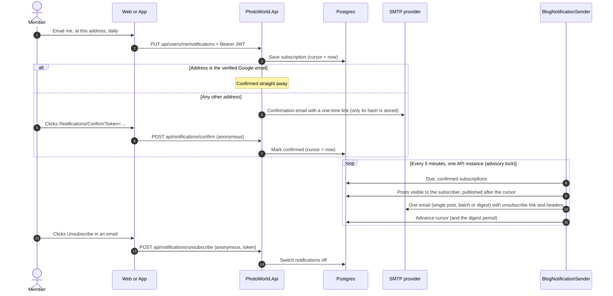

- Data: one `email_subscriptions` row per member (address, frequency, on/off, confirmed, cursor, digest period,
  weekly summary on/off and its period, unsubscribe token); it cascades on account deletion.
- **Weekly summary.** `WeeklySummarySender` (same schedule, its own advisory lock) emails members who switched it
  on, once 7 days have passed since `weekly_summary_from`: views, likes, comments, feedback and new followers on their
  photos, walks in the coming week (public ones from people they follow, and their clubs' walks), and open
  challenges (site-wide ones and their clubs'). A quiet week sends nothing; the
  period moves on either way, and a failed send is retried. The unsubscribe link switches off both kinds of email.
- Only posts the subscriber could see on the site are sent: published, not hidden by moderation, not their own.
- No SMTP host configured (development): emails are written as `.eml` files to `src/PhotoWorld.Api/emails/`.

## 11. Push notifications

The server side is in place and **switched off until keys are configured**; the app registers for push once an
Apple push key and a Firebase project exist (README → Push notifications).

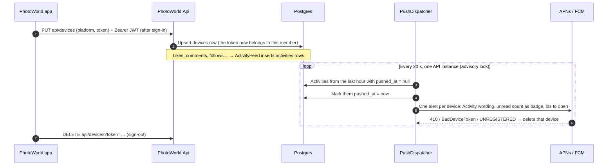

- **APNs**: HTTP/2 to `api.push.apple.com` (or the sandbox), authenticated with an ES256 provider token signed by the
  `.p8` key and reused for 50 minutes. **FCM**: HTTP v1 `messages:send`, with an OAuth token from the service-account
  key (RS256 assertion), cached until it expires. Both are in `Services/Push`; the payloads and tokens are unit-tested.
- Members with "Also send them to my phone" switched off (`activity_settings.push`), suspended members and anyone
  without a registered phone just get their items marked as handled.

## 12. Logging

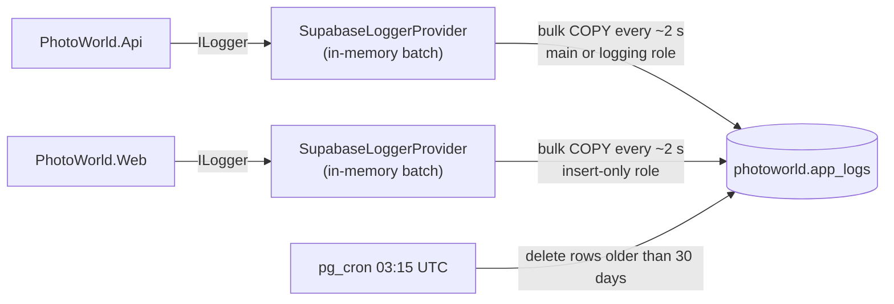

- Both apps log through the same provider (in Shared), tagged `PhotoWorld.Api` / `PhotoWorld.Web`. Logging never
  blocks a request; if Supabase is unreachable a batch is dropped and a line goes to stderr.
- The Web holds only the insert-only `photoworld_logger` role, never the main database password.
- The mobile app logs to the device console only (Debug builds).

## 13. Build, CI and database migrations

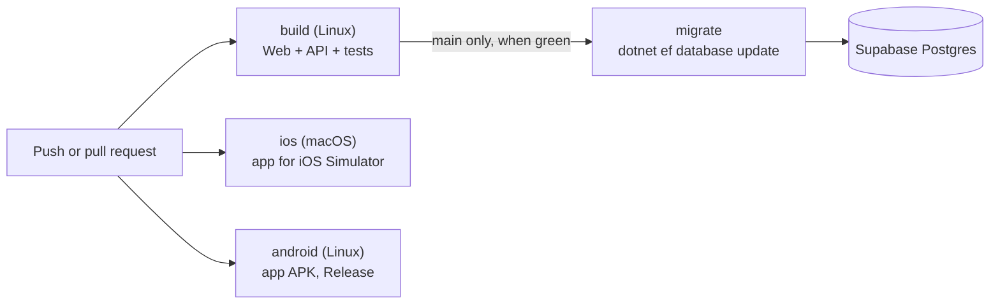

- [`.github/workflows/ci.yml`](../.github/workflows/ci.yml) runs four jobs. `migrate` needs the
  `SUPABASE_DB_CONNECTION_STRING` repository secret.
- Tests use xunit v3 on **Microsoft.Testing.Platform**: `global.json` opts `dotnet test` into that mode, which takes
  the project with `--project` (`dotnet test --project tests/PhotoWorld.Api.Tests`).
- **The SDK is pinned** in `global.json` (`10.0.402`), and every CI job installs exactly that with `setup-dotnet`'s
  `global-json-file`. A floating `10.0.x` broke CI when a new SDK was announced before its downloads were available.
  Leave out `rollForward`: with `latestPatch`, `setup-dotnet` asks for the newest patch of the band (`10.0.4xx`) and
  fails the same way. Locally the SDK still rolls forward to a newer installed patch by default. Moving to a newer
  SDK is a one-line change there.
- **Migrations are never applied at startup**, so several API instances can't race. The API logs a warning if the
  database is behind. `docs/supabase-schema.sql` is the same schema as an idempotent script.
- Deployment of the API and Web, and publishing the app to the App Store / Google Play, aren't automated yet (see the
  README checklists).

## 14. Configuration and secrets

Secrets are never in `appsettings.json`: user-secrets in development, environment variables / a secret store in
production, a git-ignored `Local.props` for the app.

| Setting | Where | Used by | Purpose |
|---|---|---|---|
| `ConnectionStrings:PhotoWorld` | API user-secrets | API, CI (`migrate`) | Supabase Postgres (session pooler) |
| `ConnectionStrings:Logging` | Web (and optionally API) user-secrets | Web, API | Insert-only logging role |
| `Supabase:SecretKey`, `Supabase:Url` | API user-secrets / settings | API | Storage uploads and deletes |
| `Supabase:ImageTransforms` | API `appsettings.json` (default `false`) | API | Thumbnails via Supabase's resize endpoint (Pro plan or higher) |
| `Jwt:SigningKey` (+ issuer, audience, lifetime) | API user-secrets / `appsettings.json` | API | Signing and validating PhotoWorld JWTs |
| `Authentication:Google:ClientId` / `ClientSecret` | Web user-secrets (ID also in API) | Web, API | Google OAuth; the API checks `aud` |
| `PhotoWorldApi:BaseUrl` | Web `appsettings.json` | Web | Where the API is |
| `Site:ContactEmail` | Web `appsettings.json` | Web | Privacy policy contact |
| `Site:Social:Facebook` / `Instagram` / `YouTube` | Web `appsettings.json` | Web | Footer social links (each hidden while empty) |
| `AppConfig.ApiBaseUrl` / `WebBaseUrl` | `App/AppConfig.cs` | App | API and sign-in URLs (Debug: localhost) |
| `GoogleMapsApiKey`, `JavaSdkDirectory` | `App/Local.props` (git-ignored) | App (Android) | Places map key; local JDK |
| `Email:Smtp:*`, `Email:From` | API user-secrets | API | Sending notification emails (none set: `.eml` files) |
| `Email:WebBaseUrl`, `Email:PollMinutes` | API `appsettings*.json` | API | Links in emails; how often the sender runs |
| `Push:Apns:TeamId`, `KeyId`, `BundleId`, `PrivateKey`, `UseSandbox` | API user-secrets | API | iPhone push (off when unset) |
| `Push:Fcm:ServiceAccountJson` | API user-secrets | API | Android push (off when unset) |

## 15. Design decisions

| Decision | Why |
|---|---|
| UI and API as separate apps | The website and the mobile app share one API, and only the API holds database credentials. |
| Google tokens verified by the API, then a PhotoWorld JWT | One token format for all clients; the API never trusts a client's claim about who the member is. |
| JWT kept server-side in the Web's cookie | The browser never sees an API token, so scripts can't steal one. |
| App signs in through the website (PKCE-style) | No separate mobile Google client or API change; intercepted redirects are useless. |
| Dedicated `photoworld` schema | Supabase's auto-generated Data API exposes `public`; this data is only reachable through the API. |
| Photos re-encoded, originals discarded | Strips GPS and other metadata before files reach a public bucket. |
| Moderation as one shared expression | The same visibility rule in every query, translated to SQL. |
| Public portfolios are opt-in, per photo, and read through `PhotoVisibleTo(null)` | The only member content open to the internet is what its owner picked and what any signed-out visitor could already see on the home page. |
| Golden hour computed locally, not from a weather or astronomy API | No key, no cost, works offline in the app, and no place a member plans to visit is sent to anyone. |
| Light forecasts from Open-Meteo, with rounded coordinates, through the API | The weather does need a service: the API sends only ~1 km coordinates (never names or members), caches them hourly, and keeps clients free of a second weather integration. |
| Club photos stay public; club walks are members-only | Photos are already public, and a club only groups them. A meeting point at a set time is personal, so a club walk is hidden from non-members by the visibility rule. |
| Club photo alerts grouped to one a day per club | A busy club would otherwise flood its members; the feed shows everything, the alert just says there's something new. |
| Image transforms behind a setting, off by default | Supabase's Free plan has none; with it on, uploads store one image and every stored path stays valid if it's switched off again. |
| A before image sends an approved photo back for approval | It's a new image: approving the photo shouldn't approve whatever is added later. |
| Members' photos approved before they're shown, through the visibility rule | One condition in `PhotoVisibleTo` covers every place a photo appears, so nothing can leak a pending photo by forgetting a check. |
| Members' blog posts approved before publication; edits to approved posts aren't | A first look at every new post without making regular authors wait for each correction; reports still cover later edits. |
| Challenge votes are likes, standings computed on read | No second voting system to build or abuse, no background job, and moderation or deletions are reflected straight away. |
| Admins in the database (`users.is_admin`) | Managed from the Users page without redeploying; nobody can demote or suspend themselves, so there's always an admin. |
| Push from the activity table, not from each action | One sender with one rule set (settings, blocks, suspension) and a single place to retry; actions stay fast. |
| Tags as rows, search with `lower(...) LIKE` | Simple, exact tag pages with an index; fine at PhotoWorld's size. Postgres full-text search is the next step if it grows. |
| Places private by route design | There is no route that takes another member's id, so there's nothing to get wrong. |
| Migrations by CI, not at startup | Safe with several API instances; schema changes are deliberate. |
| DTOs and routes in Shared | API, website and app compile against the same contract. |
